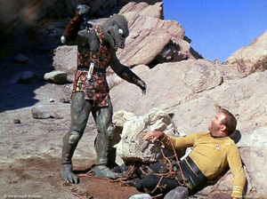

## Люди в кумедних костюмах

Уже невідь-скільки разів люди літали у космос у пошуках життя на далеких зорях, але щоразу виявлялося, що ті позаземці — зовсім як люди: тільки в кумедних костюмах, трохи підфарбовані гримом, у латексі, або ж звичайні бежеві кавказці.

Аж не віриться: обриси людського тіла виявляються настільки універсальними у всесвіті, що всі інші позаземні види відрізняються лише кількома незначними модифікаціями.

Яке можливе пояснення цьому дивовижному явищу? Звісно ж, конвергентна еволюція! І хоча ці позаземні форми життя розвивалися на інших планетах, цілковито незалежно від земного життя, усі вони прийшли до однієї точки розвитку.

Нехай вас не вводить в оману те, що кенгуру (ссавець) менш подібне до нас за шимпанзе (примат), або те, що жаба — в амфібій, як і в нас, чотири кінцівки — схожа на нас менше, ніж кенгуру. Нехай вас не вводить в оману і приголомшливе розмаїття комах, що відокремилися від нас ще раніше за жаб; нехай вас не збивають з пантелику ані шість кінцівок у комах, ані їхній зовнішній скелет, ані інша система зору, ані навіть відмінні способи розмноження.

Певно, ви думаєте, що справжній позаземний вид відрізнявся б від нас ще більше, ніж ми від комах: позаземці не виходили б із ДНК і не складалися б зі складених вуглеводних ланцюжків, внутрішньо скріплених вандерваальсівським зв’язком (білками).

Як я вже писав, нехай усе це не вводить вас в оману. Щоб позаземний вид еволюціонував до *інтелекту*, у нього мають бути дві ноги з одним коліном кожна, прикріплені до вертикального тулуба, і пересуватися він має приблизно так само, як ми. Бачте, жоден *інтелект* не обійдеться без рук, а для цього потрібно переформатувати одну пару кінцівок; якщо ця істота не має чотирьох кінцівок, вона, звісно, не розвине здатності бігати і ходити прямо без допомоги рук.

Щоб позаземний вид еволюціонував до *інтелекту*, йому потрібен бінокулярний зір для точної взаємодії з реальністю — отже, конче необхідні саме два ока. Ці очі мають розташовуватися на голові, що сидить на тулубі, а не десь-інде. Позаземець комунікує виключно шляхом перекладу думок в акустичні вібрації, а для цього йому потрібні вуха, губи й горло. А як вже є вуха, очі й губи, то куди ж без носа! Статевий добір у жодному разі не залишить без носа. От вам захотілося б сходитися з кимось без обличчя? Отож. Схожа логіка пояснює й те, чому жіночі особини цього виду без винятку привабливі: потворні іншопланетяни просто не мали б достатнього репродуктивного успіху. А чому позаземці розмовляють англійською? Бо якби розмовляли якоюсь абракадаброю, то дідька лисого збудували б повноцінну цивілізацію.

...або суто заради *альтернативної* гіпотези *можемо* припустити, що людей у кумедних костюмах використовувати *куди простіше*.

Але справа навіть не в формі — вона в розумі. Термін «люди в кумедних костюмах» добре відомі у фанатських спільнотах наукової фантастики. І він *не* позначає прямоходячу істоту з чотирма кінцівками. Кутаста істота з чистого кришталю являє собою «людину в кумедному костюмі», якщо вона *мислить* точнісінько як людина, особливо людина з англомовного світу кінця XX — початку XXI століття.

Я не дивлюся багато старих фільмів. Кілька років тому, переглядаючи стрічку «Психо» (1960), я гостро відчув культурну прірву між Америкою, яку я побачив на екрані, та Америкою, яку знав. Оці персонажі в сорочках із ґудзиками здалися мені значно чужішими за добру частину так званих позаземців, яких я бачу по телевізору чи на срібному екрані.

Щоб змалювати культуру, не схожу на власну, варто навчитися бачити свою як *окремий випадок*, а не норму — не як точку відліку, від якої мають відштовхуватися всі інші культури. У цьому може допомогти історія, хоча й вона — лише чорні літерки на білому папері, а не ваш живий досвід. Думаю, від року проживання у Китаї, Дубаї чи навіть у племені кунґ було б більше користі... і навіть цього я не зробив через мою зайнятість. Часом мені думається, скількох речей я міг не помічати — навіть не в іншій культурі, а у своїй.

А розглядати *все людство* як окремий випадок ще складніше.

У кожній відомій культурі люди, вочевидь, переживають радість, сум, страх, відразу, злість і здивування. У кожній відомій культурі ці емоції відображаються однаковими виразами обличчя. Тож наступного разу, коли побачите «позаземця» — чи, зрештою, «штучний інтелект», — закладаюся, що при гніві (а він таки гніватиметься) на його обличчі з’являться риси, характерні для будь-якої людини у стані злості.

Ми, люди, дуже подібні між собою тим, що у нас під черепами, — так уже влаштовані види зі статевим розмноженням: не може бути так, щоб кожен мав набір радикально різних складних адаптацій — вони просто не змогли б зібратися в єдину систему. (Чи розмножуються позаземці статевим шляхом, як люди та багато комах? Чи мають вони невеликі спільні фрагменти генетичного матеріалу, як бактерії? Чи формують вони колонії, як гриби? Чи діє серед них закон психологічної єдності?)

Вашим предкам доводилося *маніпулювати* — *деталізовано* моделювати, а не просто приручати чи піймати у сіті — розумами, які працювали більш-менш подібно до їхніх власних. Так ми еволюціонували до навички передбачати Інші Розуми, навчилися ставити *себе* на їхнє місце, питати, що ми зробили б у їхній ситуації. Адже все, що потребувало передбачення, було подібним до того, хто передбачає.

«Що? — скажете ви. — Я не припускаю, що інші люди подібні до мене! Коли я сумую, вони можуть злитися! Вони вірять не в те, у що я; їхні особистості відмінні від моєї!». Подивіться з цієї сторони: людський мозок — *надзвичайно* складна фізична система. Ви не моделюєте його нейрон за нейроном чи атом за атомом. Якби вам трапилася фізична система складністю з людський мозок, *не* схожа на вашу, знадобилося б кілька поколінь науковців, щоб розплутати її. Ви *не* розумієте, як функціонує людський мозок у загальному, абстрактному сенсі; ви не можете створити мозок чи навіть комп’ютерну модель, що передбачає активність інших мізків так, як це робите *ви*.

Годі шукати якоїсь іншої причини того, що ви *взагалі* здатні осягнути щось настільки фізично складне і заледве вивчене, як мозок іншої людини, крім тієї, що ви налаштовуєте свій мозок на імітацію іншого. Ви ставите себе на місце іншого, хоч, певно, і не співпереживаєте йому. Ви накладаєте тінь злості іншого розуму і тінь його переконань на свій мозок. У вашому розумі може ніколи й не з’явитися формулювання «Що б я зробив у цій ситуації?» — аж раптом та маленька тінь іншого розуму оживає у вашому, чим запускає той самий складний механізм, що існує в голові іншої людини. Так його механізм синхронізується із вашим. І вам не втямки, як усе це відбувається. Можливо, ви зараз не злитеся, але ви знаєте: якби *ви* злилися на самого себе і думали про себе як про останнього виродка, то *ви* спробували б прибити себе...

Ось так «емпатичне висновування» (назву це так) більш-менш працює у людей.

А як щодо розумів з *інакшими* емоціями, яких ви ніколи не переживали, або розумів, які ніколи не відчували тих емоцій, з якими ви добре знайомі? Через прикладання свого мозку до іншого такого вже не змоделювати. Я можу попросити вас уявити позаземця, котрий виріс у всесвіті, де простір чотиривимірний (а не тривимірний), але ж у вас не вийде переналаштувати свою зорову кору, щоб бачити так, як той позаземець. Я можу постаратися написати історію про позаземців з іншими емоціями, але що у вас, що у мене однаково не вийде пережити їх.

Уявіть, як позаземець дивиться постановки [братів Марксів](https://uk.wikipedia.org/wiki/Брати_Маркс) і поняття зеленого не має, що відбувається на екрані або чому ви активно шукаєте подібних вражень, бо той прибулець і близько не сприймав чогось схожого на почуття гумору. А як вже почали співчувати їм через те, що вони втратили, не забувайте: *ви* ніколи не *рогатіли*.

І тут, я певен, декілька читачів візьмуться фантазувати, чому еволюція неминуче породжує інтелект з почуттям гумору, навіть якщо вона взагалі його породжує. А може, позаземці і мають почуття гумору, а це у вас несмішні жарти? Це точно як в іншій країні намагатися говорити англійською дуже гучно і дуже повільно — ніби в теорії іноземці мають внутрішнього духа, що вловлює *значення*, притаманні вашим словам, якщо тільки ви вимовляєте їх досить голосно, аби подолати якийсь дивний бар’єр, що стоїть на заваді вашій універсально зрозумілій англійській.

Не без того, щоб цінувати таке прекрасне і варте явище як сміх, навіть якщо він виявиться не універсалізовним, навіть якщо він не притаманний усім можливим розумам. Нехай він став би нашою *особливою* складовою дару, який ми передаємо завтрашньому дню. Це теж може мати значення. І краще б воно мало, адже універсалізовність — одне з тих метаетичних понять, що я не можу для вас врятувати. Щось може бути універсалізовним серед людей, але не серед усіх можливих розумів.

Без протиставлення ми не мислимо себе як людей. Режисери, які зображували прибульців викрадачами дівчат у розірваному одязі, припустилися цієї помилки не через осмислення імовірної еволюції позаземних розумів. Просто у них склалося враження, що дівчина у роздертому одязі викликає хіть, причому ця властивість стосується як дівчини, так і її одягу, хоча до позаземців жодного стосунку вона не має. Англійські слова *містять* значення, жарти *є* кумедними. Який стосунок попереднє речення має до позаземців?

Антропоморфізм так глибоко вкорінився у наших розумах, що годі викорчувати його самим лише зусиллям волі чи рішучою заявою: «Відтепер я присягаюся більше не думати як людина!». Людськість — що повітря, яким ми дихаємо; *полотно*, на якому накидаємо ескізи. Навіть якщо уявити, як слизьке чудовисько спаровується з подібними йому, все ж важко *позбутися* думки, що воно віддасть перевагу дівчині в розірваному одязі як бажанішій і спокусливішій здобичі. Складно уявити, що воно *не* скаже: «А знаєте: це ж я спаровувався зі слизькими чудовиськами, допоки не побачив землянок. До біса їх — землянки куди кращі».

А як щодо ро́зумів без емоційних систем, у яких навіть немає аналогів емоцій? Ні, не поспішайте пояснювати, чому інтелектуальний розум, здатний будувати складні механізми, неминуче розвине стани, аналогічні до емоцій. Натомість поцікавтеся еволюційною біологією: природний добір створює складні механізми й при цьому не має емоцій. А тепер *представляю* вам справжнього чужого — оптимізаційний процес, що функціонує *зовсім* не так, як ви.

Значна частина прогресу в біології від 1960-х років полягала у спробі накласти мораторій на антропоморфізацію еволюції. То була головна академічна сварка, і я не певен, чи взяв би глузд гору, якби не переконливі експериментальні свідчення, підкріплені чіткою математикою. Змусити людей перестати ставити себе на місце Іншого — довга і важка робота. У галузі ШІ я борюся за це роками.

У науковій фантастиці лакмусом таланту автора є його спроможність виписати справжніх чужих. (І не просто якихось незбагненних позаземців, зручних авторові тим, що їхньою таємничістю можна виправдати будь-який сюжетний поворот.) Джек Венс був серед корифеїв цього мистецтва. Якщо Венс вписував у свій твір *людей* іншої культури, вони були більш чужими, ніж більшість «чужопланетян». (Кажете, ніколи не читали його? Раджу почати з роману «Місто Чаш» (City of the Chasch).) Куди ж без «Порошинки в оці Бога» Ні́вена і Пурне́лля.

І навпаки — пригадую, як читав, що один письменник (здається, О́рсон Скотт Кард) нарікав на найгірший епізод «Зоряного шляху» за всю історію серіалу. У ньому йшлося про паралельну еволюцію, яка породила позаземців, що не лише були схожі на людей і розмовляли англійською, а й незалежно, слово в слово, переписали преамбулу до Конституції США.

Якесь глибочезне дно уяви. І не думайте, що справа лише у НФ чи ШІ. Нездатність уявити іншопланетянина обертається нездатністю побачити *самого себе* й усвідомити власну особливість. Хто ж тоді розпізнає людину, замасковану серед людей?