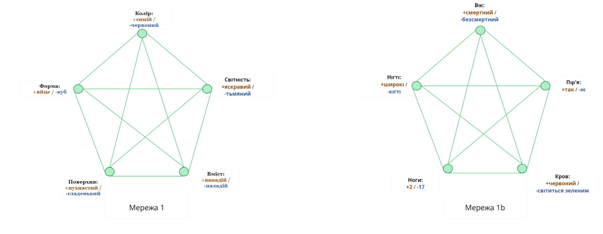
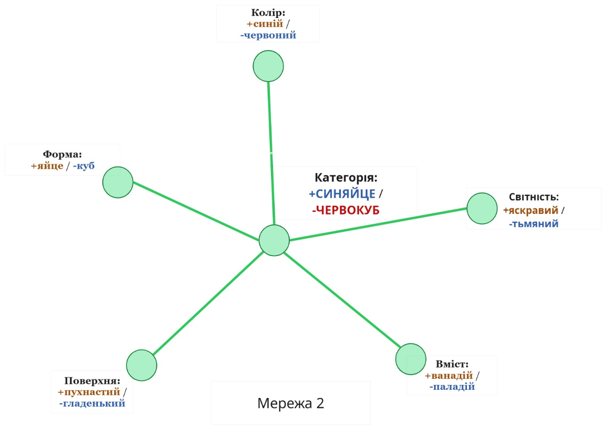

## Нейронні категорії

В есеї «Приховані запити» я писав про задачу класифікації «синяєць» і «червокубів». Типове синяйце синє, форми яйця, пухнасте, еластичне, матове, світне у темряві та містить ванадій. Типовий червокуб червоний, форми куба, гладенький, твердий, просвітний, але не світиться в темряві, містить паладій. З міркувань простоти пропоную забути про такі якості, як еластичність/твердість та матовість/просвітність. Так у нас лишається п’ять вимірів у просторі можливих об’єктів: колір, форма, поверхня, світність та вміст.

І от я хочу створити штучну нейронну мережу (ШНМ), що зі спостережуваних ознак синяйця передбачуватиме неспостережувані. Виходимо з того, що моє уявлення про ШНМ вельми наївне: в одній науково-популярній книзі я вичитав, наскільки нейронні мережі розподілені, емерджентні та паралельні — *просто як мозок людини (!!)*. Але в мене ніяк не виходить вивести диференціальні рівняння для градієнтного спуску у нециклічній багатошаровій мережі із сигмоїдними елементами (що набагато легше, ніж здається).

Потім я накреслю нейронну мережу десь такого вигляду:

Мережа 1 призначена для класифікування синяєць та червокубів. Але оскільки «синяйце» — незнайоме і штучне поняття, для порівняння я додав схожу Мережу 1b, призначену для розрізнення людей від космічних чудовиськ: у неї на вході визначення Арістотеля («Усі люди смертні») та Академії Платона («Двонога істота без пір’я із широкими нігтями»).

Нейронна мережа потребує правила навчання. Очевидно, що якщо два вузли часто активні одночасно, зв’язок між ними слід посилювати — це одне з перших запропонованих правил тренування нейромережі, відоме як правило Хе́бба.

Так, якби ви бачили об’єкти і синього кольору, і пухнасті — одночасно активували б вузол «колір» у стані + і вузол «поверхня» у стані +, — зв’язок між ними посилився б: колір+ активує поверхню+ і навпаки. Спостережувані об’єкти комбінації синього кольору, форми яйця і ванадію посилювали б позитивні взаємні зв’язки між кольором, формою та вмістом.

Скажімо, за час роботи на конвеєрі ви вже побачили чимало синяєць і червокубів. Але тепер вам трапилося щось пухнасте, яйцеподібне та — ойой! — червонувато-пурпурове (змоделюємо у «колір» з рівнем активації -2/3). А ви ж іще навіть не тестували світність чи вміст. Що передбачати? Що передбачати?

Внаслідок цього рівні активності в Мережі 1 дещо коливаються. Позитивна активація перетікає з форми у світність, негативна — з кольору у вміст, негативна — зі світності у вміст... Певна річ, усі ці команди передаються *паралельно (!!)* та *асинхронно (!!)* — зовсім як у людському мозку...

Зрештою, Мережа 1 стабілізується і проявляє високу позитивну активацію для вимірів «світності» та «вмісту». Можна сказати, що мережа «очікує» (хоча ще не побачила), що об’єкт буде світитися у темряві і містить ванадій.

Та ось Мережа 1 проявляє таку поведінку, навіть якщо не існує явного вузла, що свідчить: синяйце перед вами чи ні. Це судження *неявно присутнє по всій мережі (!!)*. Синяйцевість — це *атрактор (!!)*, котрий постає внаслідок *емерджентної поведінки (!!)* з *розподіленого (!!)* правила навчання.

А в реальному житті такого роду мережева архітектура — як [банально](https://thedailywtf.com/Articles/No,_We_Need_a_Neural_Network.aspx) це не звучало б — стикається з *цілою низкою* проблем. Циклічні мережі не завжди стабілізуються відразу: вони можуть коливатися, демонструвати хаотичну поведінку чи просто довго стабілізуватися. Ситуація, коли ви бачите щось велике, жовте і посмуговане і маєте ще почекати п’ять хвилин, щоб ваша розподілена нейронна мережа стабілізувалася до атрактору «тигр», вийде вам боком. Нехай це й асинхронно та паралельно, але не в режимі реального часу.

Крім того, вистачає й інших проблем, серед яких подвійне врахування свідчень, коли інформація передається туди й назад: підозрюєте, що об’єкт яскраво світиться в темряві, — активується переконання про вміст ванадію, а воно, своєю чергою, знову активує переконання, що об’єкт світиться в темряві.

А якщо спробуєте масштабувати архітектуру Мережі 1, для цього знадобиться O(N2) зв’язків, де N — загальне число спостережуваних величин.

Тож якою могла б виглядати більш реалістична архітектура нейромережі?

У цій мережі хвиля активації прямує від усіх зафіксованих (спостережуваних) вузлів до центрального вузла, а потім знову поширюється від нього до всіх незафіксованих (неспостережуваних) вузлів. Отже, ми можемо обчислити відповідь за один крок, а не чекати, поки мережа стабілізується — важлива вимога в біології, де нейрони активуються лише на частоті 20 Гц. А архітектура мережі масштабується як O(N), а не O(N2).

Варто визнати, що деякі нюанси легше помітити в архітектурі першої мережі, ніж другої. Мережа 1 має прямий зв’язок між кожними двома вузлами. Тож якщо червоні об’єкти *ніколи* не світяться у темряві, але червоні пухнасті об’єкти мають інші ознаки синяєць — форма яйця і ванадій, — Мережа 1 може легко відобразити такий стан речей: потрібен дуже сильний прямий негативний зв’язок з кольору до світності, але сильніші позитивні зв’язки з поверхні до решти вузлів, за винятком світності.

І те, що червоні об’єкти не світяться, не якийсь «особливий виняток» із загального правила про світність синяєць. У Мережі 1 немає ж частин, які представляють синяйцевість — вона виникає як атрактор у розподіленій мережі.

Тому так — ті зв’язки N2 давали нам якусь користь. Та й не дуже велику. У більшості реальних задач Мережа 1 не надто *корисніша* від другої, адже у природі вкрай рідко можна знайти звіра, застряглого десь посередині між котом і собакою.

(Крім того, є ще й дані, які не так просто відобразити у Мережі 1 *чи* Мережі 2. Скажімо, сполучення морського відтінку синього і форми сфери завжди позначає наявність паладію. Але коли вони ці ознаки знаходять окремо (як у виключній диз’юнкції), кожна з них слугує дуже сильним свідченням наявності ванадію. Без додаткових вузлів це складно відобразити у будь-якій архітектурі. Що Мережа 1, що Мережа 2 втілюють невисловлені припущення про те, якого роду структура середовища більш імовірна. У машинному навчанні саме здатність розпізнавати такі припущення відрізняє фахівців від новачків.)

Не переплутайте: ані Мережа 1, ані Мережа 2 не є біологічно реалістичними. *Але* все ж виправданим здається припустити, що робота мозку, якою вона б не була, ближча до Мережі 2 ніж до першої. Принцип «швидко, дешево, масштабовано» добре працює для розрізнення собак і котів: природний добір діє в таких випадках, як вода, що стрімко тече по ландшафту пристосованості.

Здавалося б, що такого надзвичайного у завданні розсортувати об’єкти на синяйця чи червокуби по відповідних контейнерах. А чи помітили б ви, якби об’єкти морського відтінку не світилися в темряві?

Можливо, якби хтось показав вам двадцять об’єктів, схожих між собою лише цим кольором, а потім вимкнув світло, жоден з них не засвітився б. Іншими словами, якби вас ткнули носом. Певно, якщо показати вам усі ті об’єкти кольору моря, ваш мозок сформує нову підкатегорію і зможе виявити ознаку «не світиться» у цій же підкатегорії. Але ви, певно, так і не помітите їх, якщо ті об’єкти будуть розкидані серед сотень синяєць і червокубів. Уже не так *легко* чи *інтуїтивно*, як із розрізненням котів і собак.

А от із «Сократ — людина. Усі люди смертні. Отже, Сократ смертний». Звідки Арістотель знав, що Сократ — людина? Так, у Сократа не росло пір’я, були широкі нігті, він ходив на двох, говорив давньогрецькою, мав людську тілобудову і поводився як людина. Тож мозок, зрештою, доходить висновку, що Сократ — людина, і на цій підставі припускає, що він смертний, як і всі інші спостережувані люди. Запитати, наскільки носіння одягу, на відміну від користування мовою, асоціюється зі смертністю, не виглядає простим чи інтуїтивним завданням. Просто «істоти, які носять одяг і користуються мовою, — це люди», а «люди смертні».

Чи виникають біаси, пов’язані зі спробою віднести об’єкт до категорії раз і назавжди? Певна річ. Про це можете прочитати в есеї «Сектантське сектоборство».

Далі буде...