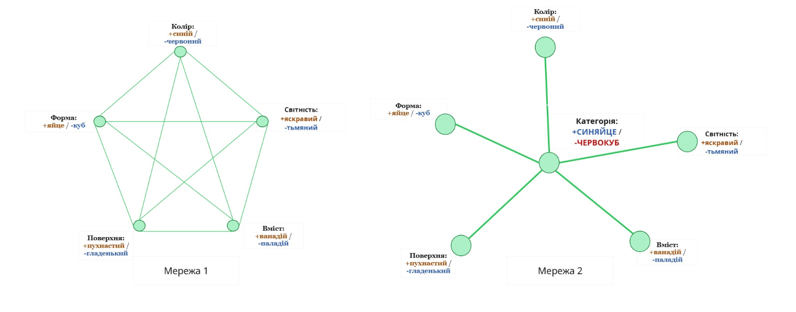

## Як алгоритм відчувається зсередини

«Чи видає звук дерево, яке падає у безлюдному лісі?» — пам’ятаю, як із цього приводу почалася цілком наївна суперечка, далека навіть від беркліанського суб’єктивного ідеалізму. От як тут:

> — Воно видає звук, як і інші дерева при падінні!
> — Але який може бути звук, якщо його ніхто не чує?

За типовим раціоналістським поглядом, перший говорить за «звук» у значенні акустичних коливань у повітрі, а другий — у значенні слухового досвіду. Відповіді на питання «Чи існують акустичні коливання?» та «Чи існують слухові досвіди?» очевидні без роздумів. Тож насправді суперечка йде за визначення слова «звук».

Як на мене, стандартний аналіз у цілому коректний. Візьмімо його за основу і запитаймо: чому люди беруть участь у такого роду суперечках? Яка психологія стоїть за ними?

Основна ідея програми евристик і біасів полягає в тому, що помилки часто дають більше уявлення про процес мислення ніж правильні відповіді. Вступати у палку суперечку про те, чи при падінні дерево видає звук, традиційно вважається помилкою.

Тож якого роду будова розуму відповідає цій помилці?

В есеї «Приховані запити» я впровадив класифікаційне завдання на розрізнення синяєць та червокубів. Старша сортувальниця Сюзен вводила вас у суть роботи: сортувати об’єкти з конвеєрної стрічки треба по контейнерах — сині яйця мають лежати у контейнері для синяєць, а червоні куби — у контейнері для червокубів. Виявляється, такий розподіл зумовлюється наявністю дрібних самородків ванадієвої руди у синяйцях, червокуби ж містять паладій. Обидві копалини важливі для промисловості.

За винятком близько 2% синіх яйцеподібних об’єктів, всередині яких паладій. То якщо ви знаходите синій яйцеподібний об’єкт із паладієм, його треба називати «червокубом»? Ви ж все одно покладете його у контейнер з червокубами. Чому б не назвати його «червокубом»?

А коли вимикаєте світло, майже усі синяйця ледь світяться в темряві. І сині яйцеподібні об’єкти з паладієм світитимуться в темряві з такою ж імовірністю, як і будь-який інший синій яйцеподібний об’єкт.

Якщо ви знаходите синій яйцеподібний об’єкт із паладієм усередині й питаєте: «Це синяйце?», відповідь залежить від того, що ви робитимете з нею. Якщо питаєте «У котрий контейнер іде об’єкт?», тоді обираєте так, ніби у вас червокуб. Але якщо ви питаєте: «Чи сяятиме він у вимкненому світлі?», ви дієте так, ніби у вас синяйце. У першому випадку питання «Це синяйце?» позначає прихований запит «У котрий контейнер його треба кидати?», у другому — запит «Чи сяятиме він у вимкненому світлі?».

А тепер уявіть синій яйцеподібний об’єкт із паладієм усередині: ви вже пересвідчилися, що на ньому хутро; він гнучкий, матовий і сяє у темряві.

У вас уже є всі *відповіді* на кожен запит, є всі введені спостереження. Замаскованих запитів уже *не лишилося*.

Чому тоді хтось усе ще поривається розвинути суперечку про те, чи об’єкт *дійсно* є синяйцем?

Ця діаграма з есею «Нейронні категорії» показує дві різні нейромережі, за допомогою яких можна відповідати на питання про синяйця та червокуби. У Мережі 1 низка недоліків: потенційно нестабільна/хаотична поведінка чи потреба в O(N2) зв’язках. Проте структура Мережі 1 має значну перевагу над Мережею 2: кожен мережевий елемент відповідає тестовному запиту. Якщо спостерігати всі спостережувані величини й зафіксувати значення кожної з них, у мережі не залишиться жодного обчислювального елемента.

Однак Мережа 2 куди краще підходить до чогось настільки ж невизначеного, як робота людського мозку: вона швидка, дешева, масштабована і має додатковий підвісний елемент у центрі, який може або активуватися, або ні, навіть після того, як ми спостерегли кожен з навколишніх вузлів.

Тобто навіть по тому, як ви дізналися, якого кольору об’єкт (синього чи червоного), якої форми (яйце чи куб), поверхні (пухнастий чи гладенький), світності (яскравий чи безсвітний) та якого вмісту (ванадій чи паладій), не покидає *відчуття*, що лишилося питання без відповіді — «*Це справді синяйце?*».

У нашому повсякденні акустичні коливання і слуховий досвід ідуть одним комплектом. Проте дерево, що падає у безлюдному лісі, ламає це звичне уявлення. І навіть після того, як при падінні дерево створює акустичні коливання (замість слухового досвіду), залишається *відчуття*, що питання «*Чи видало воно звук?*» зосталося без відповіді.

Ми знаємо розташування Плутона, як він рухається, знаємо його форму і масу. Але чи є він планетою?

Не забувайте: коли ви дивитеся на Мережу 2, як я її виклав тут, ви бачите алгоритм ззовні. Люди не замислюються штибу «Чи має загорятися центральний елемент?», як і не думають: «Чи має у моїй зоровій корі загорятися нейрон №12 234 320 242?».

Уявити власний мозок ззовні — значне зусилля, і навіть тоді ви не побачите свій справжній мозок. Уявите те, що, *на вашу думку* (сподіваюся, вона ґрунтуватиметься на науці), там є, а втім, зсередини у вас немає прямого доступу до структур вашої нейромережі. Ось тому елліни і не винайшли обчислювальної нейронауки.

При погляді на Мережу 2 ви дивитеся *ззовні*; те, як структура нейромережі відчувається *зсередини* (якщо ви і *є* тим мозком, що запускає алгоритм), провокує питання «То це синяйце чи як?» навіть після того, як ви знаєте кожну ознаку об’єкта.

Така прірва — серйозна перешкода, і я бачив, як вона спиняла людей на пів шляху. Бо інстинктивно свої інтуїтивні відчуття ми розпізнаємо не як «інтуїції», а як безпосередній дійсний світ. Дивлячись на зелену чашку, ви мислите її не як картинку, відтворену у вашій зоровій корі — хоч саме *це* ви і бачите, — ви думаєте, що просто бачите зелену чашку. Ви думаєте: «О, зелена чашка», а не «Картинка у моїй зоровій корі цієї чашки зелена».

І так само, коли люди сперечаються про те, чи дерево при падінні видає звук, чи Плутон належить до планет, вони не бачать, що сперечаються про те, чи слід активувати певну категоризацію у своїх нейромережах. Здається, що дерево або видає звук, або ні.

Ми знаємо розташування Плутона, як він рухається, знаємо його форму і масу. Але чи є він планетою? Аякже, були й люди, які казали: та це бійка за визначення. Але навіть такий погляд походить з Мережі 2, адже так ви сперечаєтеся про те, як саме треба під’єднати центральний елемент. Якби ваш мозок сконструювали за архітектурою Мережі 1, ви б сказали не «Залежить від того, що ви маєте під “планетою”», а «З того, що ми знаємо про орбіту, форму і масу Плутона, тут немає чого питати». Чи радше так воно *відчувалося* б — як ситуація, коли усі питання вичерпано (якби ваш мозок працював за принципами Мережі 1).

Перед тим, як ставити під сумнів свої інтуїції, маєте усвідомити, що об’єкт вашого внутрішнього взору *є* інтуїцією — якийсь мисленнєвий алгоритм, на який ви дивитеся зсередини, — а не безпосереднім сприйняттям того, якими предмети є насправді.

Гадаю, люди чіпляються за свої інтуїції не тому, що вірять у безпомильну надійність своїх мисленнєвих алгоритмів, а тому, що не можуть подивитися на свої інтуїції *зсередини своїх мисленнєвих алгоритмів*.

Ось так усе, що ви намагаєтеся сказати про помильність власного мисленнєвого алгоритму, обертається, зрештою, у протиставлення їхньому безпосередньому сприйняттю речей, якими вони є насправді, й відкидається як явно помилкове.