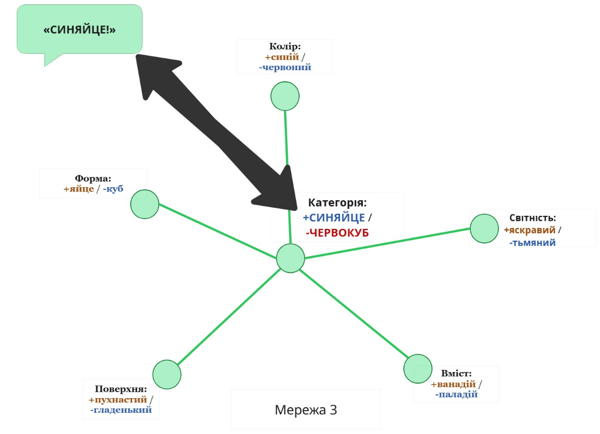

## Відчути значення

Коли хтось говорить мені: «Гляди! Метелик!», проговорені фонеми [меите́лиек] потрапляють у моє вухо, створюють вібрації у моїй барабанній перетинці, передаються до за́витки, подразнюють слухові нерви, що передають імпульси активації до слухової кори, де починаються процеси обробки фонеми, розпізнавання слів, відтворення синтаксису (ні разу не послідовний процес) та іншого роду складнощі.

Та зрештою (а точніше — наприкінці цієї секунди) я подивлюся, куди показує друг, і побачу візуальний образ, який розпізнаю як метелика. А якщо натомість раптом побачу вовка, то неабияк здивуюся.

Мій друг дивиться на метелика, його горло продукує звукові коливання, губи ворушаться; хвилі тиску непомітно для людського ока поширюються у повітрі, моє вухо вловлює їх, нерви передають, а мозок розшифровує і так далі і тому подібне — і ось я розумію, на що дивиться мій друг. Хіба не фантастика? Яким неймовірним стало б таке відкриття, якби ми не знали про хвильові коливання! Усі газети в один голос: «Люди — телепати! Люди здатні обмінюватися думками!».

Та ми *і так* телепати. Але магія вже не так зачаровує, коли вона всього лише *частина буденної реальності* і всі ваші друзі теж уміють користуватися нею.

Думаєте, телепатувати просто? А спробуйте скласти комп’ютер, що телепатуватиме з вами. Телепатія, або «мова», або як ви ще назвете здатність частково передавати думки, куди складніша, ніж видається на перший погляд.

Доволі незручно постійно думати: «А тепер я маю частково виразити деякі з моїх думок у лінійну послідовність фонем, які спровокують схожі думки у мого співрозмовника...».

Тому мозок ховає цю складність — а точніше, взагалі ніколи не відображає її, — внаслідок чого люди думають щось дивакувате про слова.

Як я писав раніше, коли смугаста істота стрибає на мене, я думаю: «Ааааа! Тигр!», а не «Хм... істоти з властивостями величини, жовтизни, смугастості часто вже володіли властивостями голоду і небезпеки, а тому, хоча не обов’язково логічно *аааааааааааа* ХРУСТЬ ХРУСТЬ КОВТЬ».

Схожим чином, коли хтось кричить «Ааааа! Тигр!», природний добір не буде прихильний до організму, який думає: «Хм... я почув склад [тигр], який мої одноплемінники асоціюють з внутрішніми аналогіями мого поняття “тигр”. Найімовірніше, вони вимовлятимуть його, коли вони категоризують *айайааааа* ХРУСТЬ ХРУСТЬ *рятуйте — моя рука* ХРУСТЬ КОВТЬ».

 Якщо взяти цю особливість за обмеження в архітектурі людського мислення, ви не захочете, щоб між моментом розпізнавання складу [тигр] вашою слуховою корою та моментом активації поняття «тигр» були *якісь* додаткові етапи.

Повертаючись до притчі про синяйця та червокуби та централізованої мережі, яка швидко й недорого класифікує інформацію, ви можете уявити прямий зв’язок від блока, що розпізнає фонеми [сиен'айце́], до центрального мережевого елемента. А центральний блок — поняття «синяйце» — активується майже відразу по тому, як ви чуєте: «Синяйце!» від старшої сортувальниці Сюзен.

До процедури (яка теж не має тривати вічність): щойно ви бачите синій яйцеподібний об’єкт і центральний блок синяйця загоряється, ви кричите Сюзен: «Синяйце!».

А от зсередини алгоритм відчувається так, ніби позначення та поняття майже *ідентичні* — тобто значення *відчувається* як внутрішня невіддільна властивість самого слова.

Знавці розпізнають у цьому ще один випадок «помилки проєкції розуму», описаної Е́двіном Дже́йнсом. Складається враження, ніби значення слова притаманне самому слову, ніби червоність — властивість самого яблука, а таємничість — властивість таємничого явища.

У більшості випадків мозок взагалі не розрізняє слово від значення, хіба що може завдати собі клопоту розділяти їх, коли вивчає нову мову. І навіть тоді, коли Сюзен покаже на синій яйцеподібний об’єкт і скаже: «Синяйце!», ви подумаєте: «*Цікаво, що означає "синяйце"*», а не «*Цікаво, яку ментальну категорію Сюзен асоціює зі слуховим позначенням "синяйце"*».

А тепер подивіться з цього боку на стандартний спір про визначення, в якому дві сторони сперечаються про те, що *насправді* означає слово «звук», як могли б сперечатися, чи конкретне яблуко *насправді* червоне чи зелене:

> Альберт: Мікрофон на моєму комп’ютері може записати звук, навіть якщо поруч немає нікого, хто б його почув, і зберегти його у файл, що буде називатися «звукозаписом». І в цьому файлі зберігається саме структура коливань повітря, а не нейронних імпульсів у чиємусь мозку. «Звук» позначає структуру коливань.
> 
> Беррі: Справді? А зазирнімо у словник.

Альберт інтуїтивно відчуває, що слово «звук» *має конкретне значення* — акустичні коливання. Так само як Альберт відчуває, що при падінні у лісі дерево *видає звук* (а не спричиняє подію, що *належить до категорії звуку*).

Беррі відчуває:

> звук.значення == слуховий досвід
> ліс.звук == хибно

Але не:

> мійМозок.ЗнайтиПоняття("звук") == поняття_Слухове&shy;Відчуття
> поняття_СлуховеВідчуття.віднести(ліс) == хибно

Друге ближче до того, що відбувається *насправді*; але люди не еволюціонували до розуміння цього, як і до інтуїтивного знання, що мозок складається з нейронів.

Конфліктні інтуїції Альберта й Беррі підживлюють подальшу суперечку, коли вона переходить до питання про те, що означає слово «звук». Така суперечка *здається* цілком звичайною емпіричною суперечкою про стан речей — ніби сперечатися про те, чи небо синє чи зелене.

Ви можете навіть не помітити, що збилися з дороги, аж поки не спробуєте виконати раціоналістський ритуал — сформулювати перевірний експеримент, результат якого залежить від тих обставин, про які ви так палко сперечаєтеся...