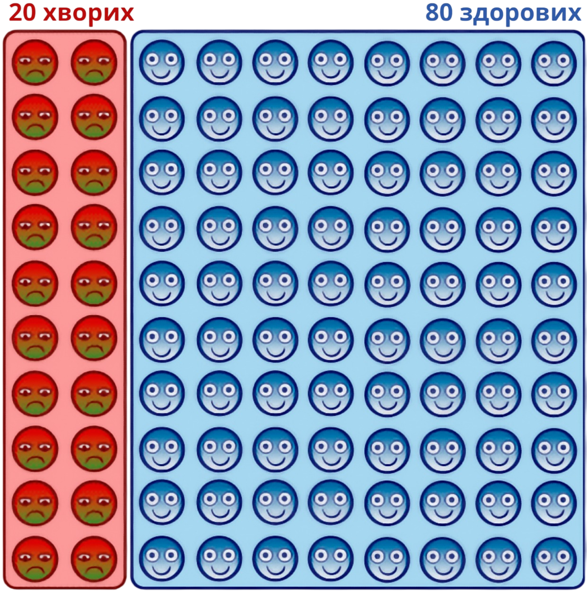
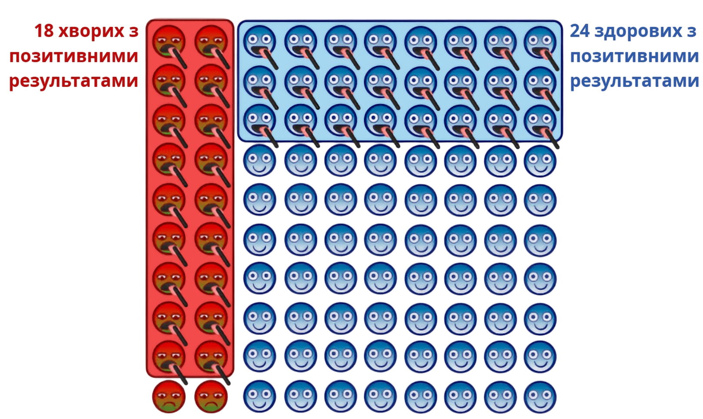
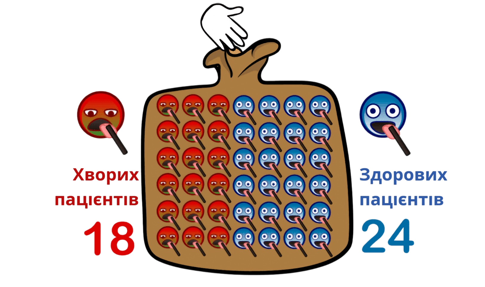

## Геометричні візуалізації: знайомство з баєсовою статистикою

Баєсове міркування показує, як переглядати власні переконання залежно від свідчень.

А почнемо ми з розгляду одного сценарію, в якому сила свідчень виражається у кількісних показниках.

(Не хвилюйтеся, якщо не розумієте, як розв’язати наступну задачу. Невдовзі ми розберемо її.)

Скажімо, у вас, як у медсестри, є завдання провести обстеження групи учнів на захворювання під назвою дисизіт.[^1]
[^1]: Буквально «запалення, викликане хворобою».

*   З минулих досліджень населення відомо, що у цю пору року на дисизіт хворіють близько 20% учнів.

Ви проводите тестування за допомогою лопатки для язика, що змінює колір: якщо вона чорніє, учень хворий на дисизіт.

*   Серед пацієнтів із дисизітом у 90% лопатка забарвлюється у чорний.
*   Та лопатка не завжди ідеально розпізнає хворобу і чорніє при контакті з 30% здорових учнів.

От учень заходить у медичний кабінет, проходить тестування, і його лопатка забарвлюється у чорний. Яка ймовірність того, що у нього дисизіт?

(*Якщо* думаєте, що розумієте, як розв’язати її, можете спробувати, а потім читати далі. Відповідь буде надана нижче.)

> Відповідь:
> Імовірність того, що лопатка чорніє при контакті з учнем, хворим на дисизіт, становить 3/7 — близько 43%.

Цю задачу можна розв’язати складним способом або розумним і легким. Почнемо зі складного.

Спочатку уявляємо сукупність зі 100 учнів, з яких 20 хворі на дисизіт, а 80 здорові.[^2]
[^2]: Численні дослідження демонструють: якщо думати про точні числа способом «20 учнів зі 100» або «200 учнів з 1000», спонтанні роздуми про подібні задачі ймовірніше вестимуть у правильному напрямку, ніж роздуми над відсотками типу «20% учнів». Одне з них — Eddy DM. [Probabilistic reasoning in clinical medicine: Problems and opportunities](https://pdf.stafforini.com/eddy-1982-probabilistic-reasoning-in.pdf). In: Kahneman D, Slovic P, Tversky A, eds. *Judgment under Uncertainty: Heuristics and Biases*. Cambridge University Press; 1982:249-267.

У 90% хворих учнів і в 30% здорових лопатка забарвлюється у чорний. Отже, ми спостерігаємо чорну лопатку у $90\% × 20 = 18$ хворих учнів і в $30\% × 80 = 24$ здорових.

Яка ймовірність того, що учень, у якого почорніла лопатка, хворий на дисизіт? На візуалізації видно, що з чорним індикатором 18 хворих учнів. Усього $18 + 24 = 42$ учні отримують позитивний результат при тестуванні. А тепер уявіть, що у вас є загальна група з учнями, у яких чорний індикатор, і ви вказуєте на випадкового учня. Який шанс того, що обраний учень хворий?

Остаточна відповідь: пацієнт із чорною лопаткою може виявитися хворим з імовірністю $18/42 = 3/7 = 43\%$.

Багатьом студентам-медикам, яким трапилася така задачка, відповідь виглядала контрінтуїтивною: тест правильно ж ідентифікує хворобу у 90% випадків! Якщо тест позитивний, чому ж тоді ймовірність того, що пацієнт хворий, менша за 50%? Водночас тест дає хибнопозитивний результат у 30% випадків. Як наслідок, у нас набагато більше хворих пацієнтів, аніж здорових.

Дійсно — цей тест дає нам якісь підстави вважати, що пацієнт хворий. Імовірність того, що він хворий, зростає з 20% до тесту до 43% після того, як ми побачили результат (чорна лопатка). Але з цього не можна виводити остаточний висновок — потрібно провести ще додаткові тести (можливо, дорожчі).

*Якщо* вам здається, що ви зрозуміли умови задачі, спробуйте відразу дати відповідь на наступне питання. Яка ймовірність того, що учень, в якого не чорніє лопатка (негативний результат), хворий на дисизіт? Знову ж — ми починаємо з 20% хворих і 80% здорових, при цьому негативний результат отримають 70% здорових учнів і тільки 10% хворих.

> Відповідь:
> Уявіть 20 хворих учнів і 80 здорових. $10\% × 20 = 2$ хворі учні отримають негативний результат. $70\% × 80 = 56$ здорових учнів отримають негативний результат. Серед загальної кількості $2 + 56 = 58$ учнів з негативним результатом 2 учнів будуть хворими з негативним результатом. Отже, $2/58 = 1/29 = 3,4\%$ учнів з негативним результатом будуть хворими на дисизіт.

З розумним способом провести ті самі обчислення можете ознайомитися у наступному есеї «Каскадні візуалізації та співвідношення шансів».