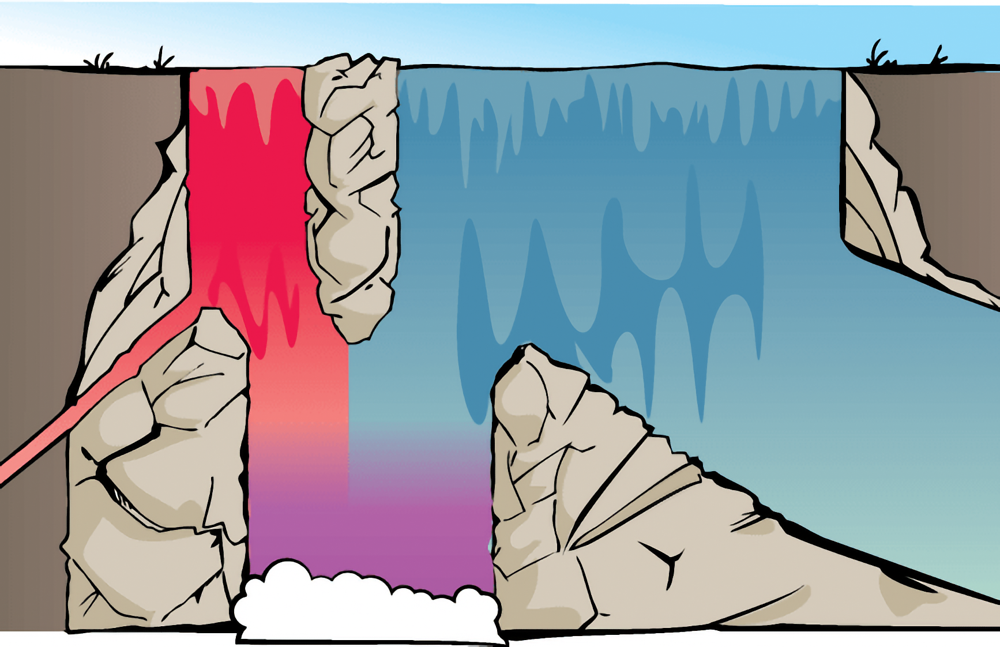
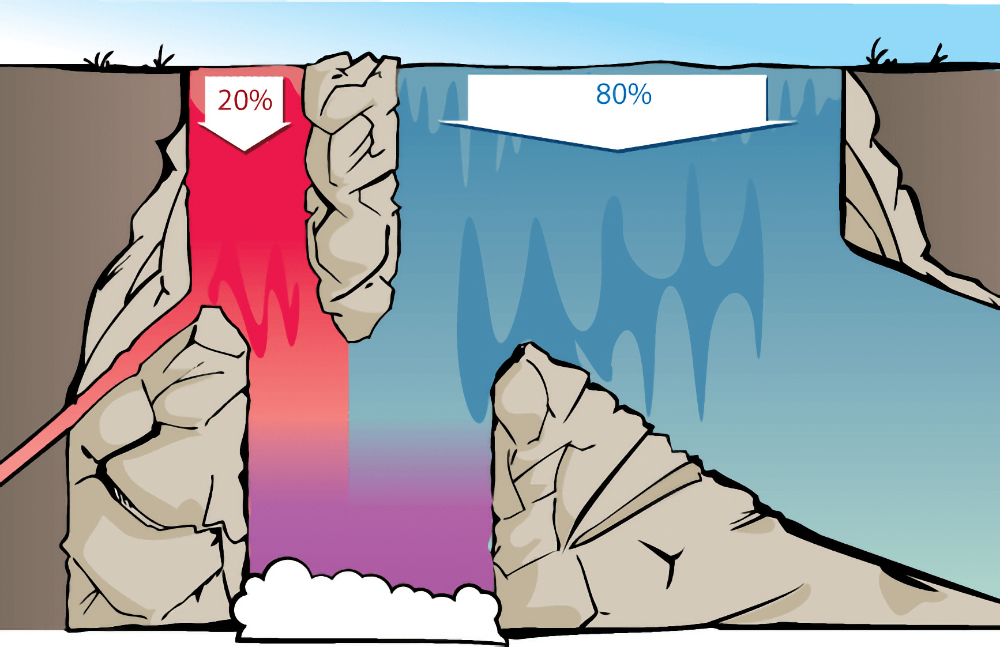
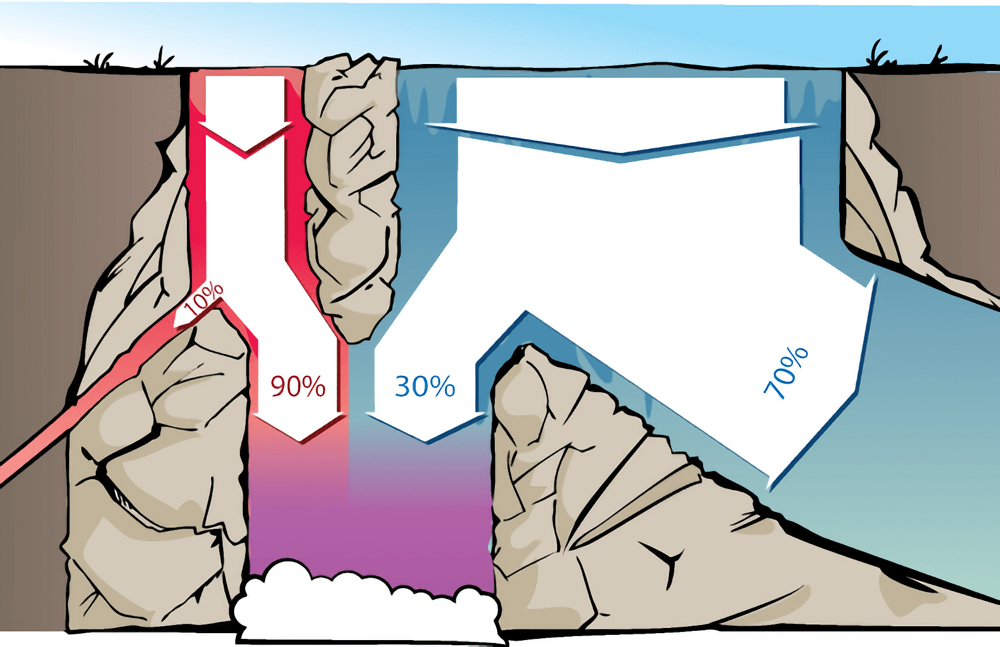
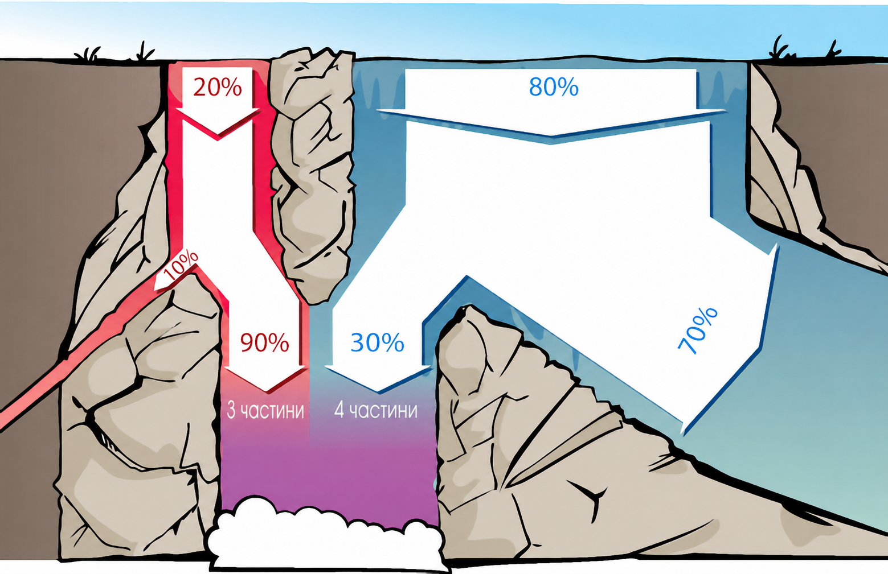

## Каскадні візуалізації та співвідношення шансів

Уявіть водоспад з двома верхніми руслами — червоним і синім. До уступу вони течуть окремо. На шляху до підніжжя якась частина води стікає в іншу сторону, а решта — у спільний нижній басейн.

Припустімо, що

*   з уступу водоспаду стікає 20 галонів червоної і 80 галонів[^1] синьої води за секунду.
*   90% червоного і 30% синього русла стікають аж до дна.
[^1]: 1 американський галон = 3,785411784 літри, тож 20 гал ≈ 75,71 л, 80 гал ≈ 302,83 л.

З тієї фіолетової води, що стекла в нижній басейн, яка частина налилася з червоного русла, а яка із синього?

Ті 20% хворих пацієнтів аналогічні до 20 галонів червоної води за секунду, а 80% здорових — до 80 галонів синьої води:

Ті 90% хворих пацієнтів, у контакті з якими лопатка для язика чорніє, аналогічні до 90% червоної води, що стікає до підніжжя водоспаду. 30% здорових пацієнтів із позитивним результатом індикатора, аналогічні до 30% синьої води, що стікає до нижнього басейну.

Отже, питання «Яка частина води натекла у нижній басейні з червоного русла?» має таку ж відповідь, що й питання «Яка частина пацієнтів, хворих на дисизит, отримує позитивний результат?».

Почнемо з того, що на уступі водоспаду *синьої води вчетверо більше, ніж червоної*.

Уже тоді кожна молекула червоної води з імовірністю 90% потрапить у нижній басейн, а кожна молекула синьої води потрапить у басейн з імовірністю 30%. (А 90% червоної і 30% синьої води стече до дна.) Отже, ймовірність того, що кожна молекула червоної води потрапить на дно, *втричі більша* ($0,9/0,3=3$), порівняно з ймовірністю для молекули синьої води.

[Завдання цього есею — пояснити ймовірності, тому вживання слова «ймовірно» — у деякому сенсі приклад циклічного мислення. А зрештою, що означає «ймовірно»? Тут ми не вдаємося до таких подробиць. Імовірність передбачає певну частоту результатів, а тому твердження вище — спроба визначити частоту результатів (щодо пропорцій червоної та синьої води, що проходить через водоспадну систему) шляхом посилання на іншу частоту результатів; звідси й виникає циклічність. Краще триматися саме пропорцій: скільки б не вилилося червоної води, стіче втричі більше ніж синьої. Скажімо, певна частка ($f$) молекул синьої води стікає вниз; тоді на кожні 100 молекул води проходить $f × 80$ синіх молекул і $3f×20$ червоних, що дає співвідношення 60f червоних до 80f синіх. Ці пропорції можна зменшити діленням обох чисельників на $f$ — отримуємо $60:80$, тобто $3:4$.]

Тож ми множимо апріорні пропорції $1:4$ (червоної води до синьої) на відносні правдоподібності $3:1$ і отримуємо кінцеві — $(1×3):(4×1) = 3:4$, тобто у нижньому басейні до 3 частин червоної води припадає 4 частини синьої.

Щоб перевести ці *відносні* пропорції в *абсолютну* ймовірність того, що випадкова молекула води на дні червона, ми рахуємо $3/(3+4)$, щоб побачити, що $3/7$ (близько $43\%$) води у нижній басейн витекла з червоного русла.

Ця пропорція не відрізняється від пропорції $18:24$ хворих пацієнтів із позитивними результатами до здорових пацієнтів із позитивними результатами, яку ми отримали б, якби думали в рамках ста пацієнтів.

Тобто, щоб у голові розв’язати задачу із дисизітом, ви можете перетворити цю текстову задачу:

> 20% пацієнтів у скринінговій популяції хворіють на дисизіт. У 90% пацієнтів з дисизітом і в 30% пацієнтів без нього чорніє лопатка для язика. Яка ймовірність того, що у пацієнта дисизіт, за умови, що його лопатка для язика почорніла?

До розрахунків:

> Такс, початкові шанси — $(20\%:80\%) = (1:4)$, правдоподібності — $(90\%:30\%) = (3:1)$. Перемноживши ці співвідношення, отримуємо шанси $(3:4)$, тобто ймовірність 3/7.

> **Як перемножити шанси, якщо ви не знайомі з математикою**
>
> Спочатку у нас є шанси $20\%:80\%$. Для такого запису шансу можна прибрати знак відсотка. Поділивши обидві частини на найменше число (20), отримаєте охайний і простий запис — $1:4$. Він читається як 1 «шанс» для червоного і 4 «шанси» для синього. Правдоподібність того, що вода сягне дна, становить 90% для червоного русла і 30% для синього, тобто можна записати як $90:30$. Якщо ви поділите обидві сторони на 30, знову отримаєте гарний запис — $3:1$. Трійка позначає шанс того, що червоне русло стіче до дна, одиниця — що синє.
>
> Щоб об’єднати їх, помножте два числа, що позначають червоне, і залиште їх ліворуч. Те саме зробіть для синього і залиште їх праворуч. 1 (початковий) помножити на 3 (правдоподібність) = 3 (кінцевий) для червоного, а 4 (початковий) помножити на 1 (правдоподібність) = 4 (кінцевий) для синього, що дає кінцевий шанс $3:4$. Щоб перетворити це число назад у відсотки, згадайте, що червоне має 3 шанси порівняно з 4 для синього. Між ними усього $3+4=7$ варіантів. У червоного — 3 з них, тому шанси 3/7 або 0,43. Як і годиться для відсотків, просто помножте десятковий дріб на 100 і матимете 43%.

(Можливо, у вас і не вийде в голові перетворити 3/7 на 43%, але на око прикиньте, що ця частина помітно менша за 50%.)

Для цієї задачі можете спробувати схожі обрахунки:

*   90% віджетів робочі, 10% несправні.
*   12% робочих віджетів іскряться.
*   І лише 4% робочих мають ту саму рису.

Який відсоток віджетів, що іскряться, несправний? Якщо вам зрозуміла умова задачі, спробуйте розв’язати її в голові від початку до кінця.

(Можете спробувати уявити водоспад із робочими та неробочими віджетами на уступі, з яких лише ті, що іскряться, спадають у нижній басейн.)

> Відповідь:
> Маємо 1:9 несправних віджетів до робочих. Відносна правдоподібність того, що несправні віджети заіскряться відносно справних, становить $12:4$. Спрощуємо до $(1:9)x(3:1)=(3:9)=(1:3)$, тобто 1 неробочий іскристий віджет до 3 робочих іскристих. Перетворюємо на ймовірності: $1/(1+3)=1/4=25%$ — тобто 25% іскристих віджетів несправні. Те, що ми бачимо іскри, не дає нам підстав вірити, що «віджет несправний», адже ймовірність сягнула лише 25%, менше ніж 50/50. Але з цього не випливає, що ми досі віримо, що віджет робочий, і можемо просто відкинути свідчення чи нехтувати ними. Несправний віджет *відносно ймовірніше* буде іскритися, а тому, отримавши таке свідчення, ми маємо вірити, що ймовірність того, що пристрій неробочий, *відносно вища*, навіть якщо вона не стала більшою за 50%. Ми підвищуємо нашу оцінку ймовірності з 10% до 25%.
