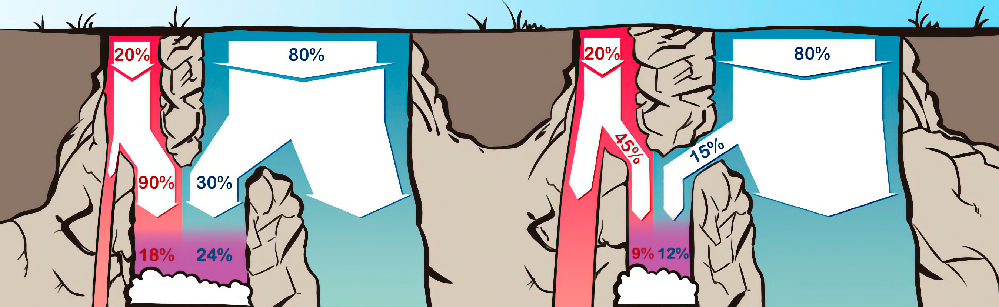
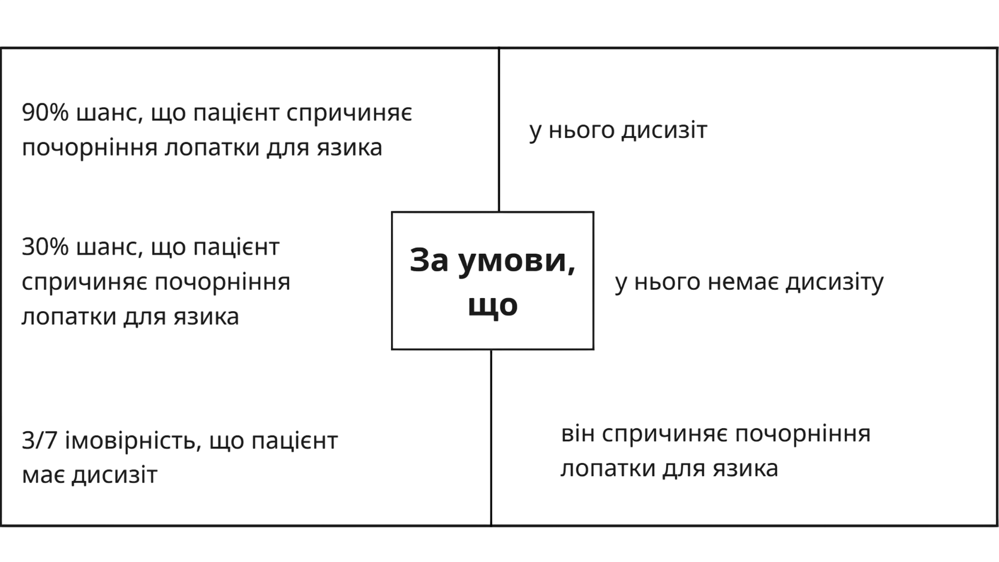
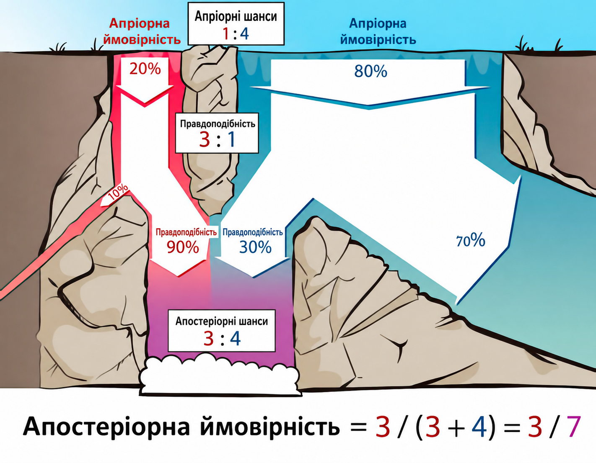
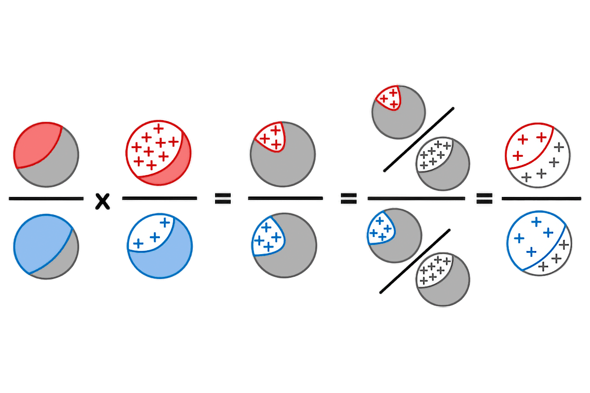

## Вступ до теореми Баєса: форма співвідношення шансів

У загальному вигляді теорема Баєса твердить:

**Апріорні шанси × Відносні правдоподібності = Апостеріорні шанси**

Ознайомившись із каскадною візуалізацією або прикладом із дисизітом, ми можемо уявити, наскільки *відносні шанси* — відповідний спосіб міркувати про задачу із двома руслами на вершині водоспаду.

*Пропорція* червоної до синьої води у нижньому басейні буде однаковою, хоч водоспадом стікає 200 галонів червоної води до 800 галонів синьої за секунду, 20&nbsp;000 до 80&nbsp;000 гал/с чи 1 до 4 гал/с. Поки решта водоспаду поводиться пропорційно, ми будемо отримувати ту саму пропорцію червоної води до синьої у нижньому басейні. Отже, ми можемо нехтувати *обсягами* води та враховувати лише відносну пропорцію між обсягами.

Так само має значення *відносна* пропорція між тим, скільки з кожного русла потрапляє червоної і синьої води у спільний басейн. 45% червоної і 15% синьої води, що стікає до нижнього басейну, дадуть ту саму *відносну пропорцію*, що й 90% червоної і 30% синьої води у спільному басейні.

Такий підхід дозволяє нехтувати конкретними даними — 90% води з червоного русла і 30% із синього стікають до нижнього басейну — і звести їх до *відносних правдоподібностей* ($3:1$).

Більш загальний випадок: скажімо, є медичний тест, що виявляє захворювання з частотою істинно позитивних результатів 90% (відповідно, хибно негативних — 10%) і частотою хибно позитивних результатів 30% (відповідно, істинно негативних — 70%). Позитивний результат цього тесту має таку ж *силу свідчень*, що й тест, де 60% істинно позитивних і 20% хибно позитивних результатів. Негативний же результат має ту ж *силу свідчень*, що й тест із 9% хибно негативних результатів і 63% істинно негативних.

Загалом, сила свідчень визначається тим, наскільки різні стани світу роблять наше спостереження ймовірним *порівняно* один з одним.

### Рівняння

Щоб сформулювати теорему Баєса у повній загальності та довести її як теорему, нам потрібно ввести деякі нові позначення.

#### Умовна ймовірність

Якщо $X$ є твердженням, то $\mathbb{P}(X)$ — ймовірність $X$.

Іншими словами, $X$ — твердження, що насправді або істинне, або хибне, про що ми не певні. $\mathbb{P}(X)$ — спосіб виразити ступінь переконаності в тому, що $X$ істинне. На ділі ж пацієнт або хворий, або здоровий, але якщо ви не знаєте його стану, свідчення можуть привести вас до 43% суб’єктивної ймовірності, що пацієнт хворий.

$¬X$ означає, що «$X$ хибне», тож $\mathbb{P}(¬X)$ — «ймовірність, що $X$ хибне».

Проте приклад із дисизітом передбачав дещо складніші твердження, зокрема:

*   Шанс, що пацієнт спричиняє почорніння лопатки для язика *за умови*, що у нього дисизіт, становить 90%.
*   Шанс, що пацієнт спричиняє почорніння лопатки для язика *за умови*, що у пацієнта немає дисизіту, становить 30%.
*   Імовірність, що пацієнт хворий на дисизіт *за умови*, що він спричинив почорніння лопатки, становить 3/7.

У таких випадках ми хочемо перейти від певного твердження, що *вважається* або *визнається* істинним (праворуч), до іншого твердження (ліворуч), нову ймовірність якого ми хочемо дізнатися, з урахуванням цього припущення.

Ось такі ймовірнісні твердження відомі як «умовні ймовірності». У стандартному записі умовної ймовірності наведені вище величини позначаються так:

*   $\mathbb{P}(почорніла|хворий) = 0,9$
*   $\mathbb{P}(почорніла |¬хворий) = 0,3$
*   $\mathbb{P}(хворий |почорніла) = 3/7$

Цей стандартний запис для $\mathbb{P}(X ∣ Y)$ — ймовірність $X$ за умови, що $Y$ істинне, — на жаль, є лише симетричною вертикальною лінією, що не дає жодної візуальної підказки для запам’ятовування того, що припущення знаходиться праворуч, а виведене твердження — ліворуч.
Умовна ймовірність визначається (запис «:=» означає «визначається як») таким чином (запис $X∧Y$ позначає «$X$ та $Y$» або «і $X$, і $Y$ істинні»):

$$
\mathbb{P}(X∣Y):=\frac{\mathbb{P}(X∧Y)}{\mathbb{P}(Y)}
$$

У прикладі з дисизітом $\mathbb{P}(хворий∣почорніла)$ обчислюється діленням 18% — частки учнів, які одночасно хворі й мають почорнілу лопатку ($\mathbb{P}(хворий∧почорніла)$), — на загальні 42% учнів, у яких лопатка просто почорніла ($\mathbb{P}(почорніла)$).

Або $\mathbb{P}(почорніла | ¬хворий)$ — імовірність почорніння лопатки *за умови*, що учень здоровий, — обчислюється як 24 (учні, які одночасно здорові *та* мають почорнілу лопатку), поділене на 80 (здорові учні). $24/80 = 3/10$, що відповідає 30% хибно позитивних результатів, про які нам говорили на початку.

Закон умовної ймовірності можна розглядати так: «Розглядатимемо лише ті світи або об’єкти, для яких $Y$ істинне. Усередині цієї множини визначимо, скільки випадків одночасно задовольняють $X\,та\,Y$».

#### Теорема Баєса
Теорема Баєса твердить:

**Апріорні шанси × Відносні правдоподібності = Апостеріорні шанси**

У прикладі з дисизітом вона б формулювалася так:

$$
\frac{\mathbb{P}(хворий)}{\mathbb{P}(здоровий)}×\frac{\mathbb{P}(почорніла∣хворий)}{\mathbb{P}(почорніла ∣здоровий)}=\frac{\mathbb{P}(хворий∣почорніла)}{\mathbb{P}(здоровий∣почорніла)}.
$$

Апріорні шанси стосуються відносної пропорції хворих до здорових пацієнтів — $1:4$. Перевівши відношення шансів на ймовірності, отримаємо $\mathbb{P}(хворий)=\frac{1}{4+1}=\frac{1}{5} = 20\%$.

Відносна правдоподібність стосується того, наскільки ймовірно, що позитивний результат отримають хворий і здоровий пацієнт. Скористаємося позначеннями умовних імовірностей: $\frac{\mathbb{P}(позитивний∣хворий)}{\mathbb{P}(позитивний∣здоровий)}=\frac{0,90}{0,30}$, тобто відносні правдо&shy;подібності $3:1$.

Апостеріорні шанси — відносні пропорції хворих до здорових пацієнтів серед тих, хто отримав позитивні результати тесту, або $\frac{\mathbb{P}(хворий∣позитивний)}{\mathbb{P}(здоровий∣позитивний)}=\frac{3}{4}$, тобто шанси $3:4$.

Щоб дістати *ймовірності* з відносних шансів, потрібно пам’ятати, що ймовірності взаємно виключних і вичерпних тверджень мусять дорівнювати одиниці, тобто 100% того, що щось станеться. Оскільки усі або не хворі, або хворі, можна нормалізувати співвідношення шансів $3:4$ через ділення на суму членів:

$
(\frac{3}{3+4}:\frac{4}{3+4})=(\frac{3}{7}:\frac{4}{7})≈(0,43:0,57)
$

... що дає нам ймовірності ($0,43:0,57$), пропорційні до початкового співвідношення ($3:4$), але він уже дорівнює одиниці. Бо якби ймовірність настання якоїсь події дорівнювала 3 (300%), то було б щось геть дивне.

Уявити це нам допоможе каскадна візуалізація:

Усі ці розрахунки можна узагальнити до *будь-якої* з двох **гіпотез** $H_j$ та $H_k$ зі **свідченням** $e$, у випадку чого теорему Баєса можна розписати так:

$$
\frac{\mathbb{P}(H_j)}{\mathbb{P}(H_k)}×\frac{\mathbb{P}(e∣H_j)}{\mathbb{P}(e∣H_k)}=\frac{\mathbb{P}(H_j∣e)}{\mathbb{P}(H_k∣e)}
$$

(читається як «апостеріорне відношення шансів для гіпотез $H_j$ проти $H_k$ (після спостереження свідчення $e$) дорівнює апріорному відношенню шансів, помноженому на відношення того, наскільки добре гіпотеза $H_j$ передбачила це свідчення порівняно з гіпотезою $H_k$»).

Якщо $H_j$ та $H_k$ взаємно виключні та вичерпні, можна перетворити ці апостеріорні шанси в апостеріорну ймовірність для $H_j$ шляхом нормалізації шансів: поділити співвідношення шансів на суму його членів, щоб сума складників нового співвідношення дорівнювала $1$.

### Доведення теореми Баєса
Переформулюємо визначення умовної ймовірності: $\mathbb{P}(X∧Y)=\mathbb{P}(Y)×\mathbb{P}(X|Y)$. Наприклад, щоб встановити «частку всіх хворих пацієнтів, які отримують позитивний результат», множимо «частку хворих пацієнтів» на «ймовірність, що у хворого пацієнта почорніє лопатка для язика».

Так і отримуємо доведення теореми Баєса, де $e_0$ — нове свідчення:

$$
\frac{\mathbb{P}(H_j)}{\mathbb{P}(H_k)}⋅\frac{\mathbb{P}(e_0|H_j)}{\mathbb{P}(e_0|H_k)}=\frac{\mathbb{P}(e_0∧H_j)}{\mathbb{P}(e_0∧H_k)}=\frac{\mathbb{P}(H_j|e_0)/\mathbb{P}(e_0)}{\mathbb{P}(H_k|e_0)/\mathbb{P}(e_0)}=\frac{\mathbb{P}(H_j|e_0)}{\mathbb{P}(H_k|e_0)}
$$

що й треба було довести.

У прикладі із дисизітом ці етапи доведення відповідають таким операціям: було б корисно, якби ви пригадали ймовірності з прикладу про дисизіт, перед тим, як я покажу формулу.

$
\frac{0,20}{0,80}×\frac{0,90}{0,30}=\frac{0,18}{0,24}=\frac{0,18/0,42}{0,24/0,42}=\frac{0,43}{0,57}
$

На візуалізації етапів обрахунку червоним кольором позначені хворі, синім — здорові, сірим — поєднання хворих і здорових пацієнтів, плюсом позначені позитивні результати тестів:

Цей процес спостереження за свідченнями і застосування їхнього співвідношення правдоподібності для перетворення апріорного переконання на апостеріорне зветься «баєсовим оновленням» або «переглядом переконання».

*   Про узагальнення теореми Баєса у формі співвідношення шансів до багатьох гіпотез і свідчень читайте у «Теорема Баєса: векторна форма».
*   Про трансформацію форми шансів, що ще більше унаочнює силу свідчень, читайте «Теорема Баєса: логарифмічні відношення шансів». 
