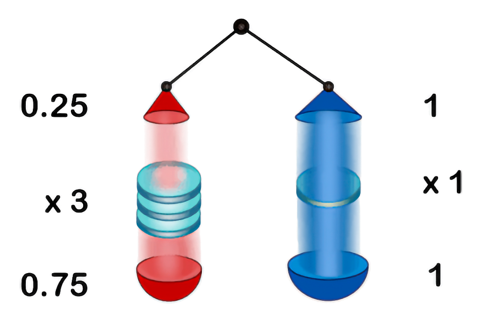

## Теорема Баєса: пропорційна форма

Якщо $H_i$ та $H_j$ — гіпотези, а $e$ — свідчення, тоді теорема Баєса твердить:

$$
\frac{\mathbb{P}(H_i)}{\mathbb{P}(H_j)}×\frac{\mathbb{P}(e∣H_i)}{\mathbb{P}(e∣H_j)}=\frac{\mathbb{P}(H_i∣e)}{\mathbb{P}(H_j∣e)}
$$

У задачі із дисизітом хворобу мають 20% пацієнтів з цільової популяції, у 90% хворих і 30% здорових пацієнтів спостерігаємо почорніння індикаторної смужки. Цю задачу можна розв'язати за допомогою формули Баєса, наведеної вище: $(1:4)×(3:1)=3:4$.

Якщо замість співвідношення шансів обчислити числа для кожного члена рівняння, натомість отримаємо такі розрахунки: $\frac{1}{4}×\frac{3}{1}=\frac{3}{4}$ або $0,25×3=0,75$.

Безпосередньо витлумачити цей запис можна так: «Якщо спочатку шанси того, що пацієнт хворий, проти того, що він здоровий, становлять 0,25, а результат аналізу втричі правдоподібніший за умови, що пацієнт хворий, ніж за умови, що він здоровий, то робимо висновок, що шанси того, що пацієнт хворий, проти того, що він здоровий, становлять 0,75».

Так виглядає правильне міркування, і таку форму Баєсової теореми називаємо *пропорційною*. Якщо ми захочемо повернутися до ймовірнісної форми, тоді міркуємо так: якщо на кожного 1 здорового пацієнта припадає 0,75 хворих, маємо $0,75/(0,75+1)=3/7=43\%$ хворих пацієнтів.

### Прожекторна візуалізація

Один зі способів подивитися на цей результат: оскільки при множенні на додатну константу співвідношення шансів еквівалентні, ми можемо зафіксувати праву сторону співвідношення як рівну одиниці та з'ясувати, що міститься зліва. Саме так ми і робимо, коли бачимо розрахунок типу $(0,25:1)⋅(3:1)=0,75:1$ — форму, запропоновану доведеною вище теоремою.

Ми можемо візуалізувати теорему Баєса як пару прожекторів із різною початковою інтенсивністю, світло від яких проходить крізь лінзи, що посилюють або послаблюють кожну вхідну одиницю світла на фіксований множник. У випадку із дисизітом, якщо ми зафіксуємо для правого синього променя початкову інтенсивність 1 і множник лінзи 1, а для лівого променя — початкову інтенсивність 0,25 і множник лінзи 3x, то отримаємо візуалізацію обчислення, передбаченого теоремою Баєса:

Зауважте подібність прожекторної візуалізації до каскадної. Головне, що додає прожекторна візуалізація, — вона допомагає уявити абсолютну інтенсивність джерел світла та лінз і при цьому зберегти відносну так, щоб промені й лінзи праворуч мали значення, рівні одиниці.

### Застосування для побудови аргументу

Певно, пропорційна форма Баєсової теореми — найшвидший спосіб описати баєсове міркування, і звучить вона так, ніби має бути істинною. Якби ви прописували художнього персонажа, який зненацька видає баєсівський аргумент посеред історії, а її читачі якої ні сном ні духом про Баєсову теорему, мабуть, ви б вклали у його вуста такі слова:

> «Припустимо, що мітка точно продовжить своє існування, якщо розум Темного Лорда живе, але заздалегідь ми б припустили, що з імовірністю 20 відсотків Чорна мітка продовжить існування після смерти Темного Лорда. Тоді спостереження "Чорна мітка не зникла" впʼятеро імовірніша у світах, де Темний Лорд живий, ніж у світах, де він мертвий. Невже це можна порівняти з апріорною імовірністю безсмертя? Скажімо, апріорна оцінка того, що Темний Лорд виживе, — один до ста. Якщо гіпотеза в сто разів імовірніше хибна, ніж істинна, а тоді ми бачимо свідчення впʼятеро разів імовірніше за умови, що ця гіпотеза істинна, треба оновити віру в гіпотезу до «у двадцять разів більш імовірно хибна, ніж істинна». Шанси один до ста, помножені на співвідношення імовірності один до пʼяти дорівнює шансам один до двадцяти, що Темний Лорд мертвий…​».[^1]

[^1]: Узяв з українськомовного перекладу «Гаррі Поттер і Методи Раціональности» ([Розділ 86. Перевірка чисельних гіпотез](https://xn--c1asif2i.xn--j1amh/086.html)). Невеличке зауваження: у цьому есеї йдеться не стільки про ймовірності, скільки про шанси — співвідношення двох взаємовиключних альтернатив (шанс того, що пацієнт «$хворий:здоровий$», що гіпотеза «$істинна:хибна$», що Темний Лорд «$живий:мертвий$»). — Прим. пер.

Схожим чином, якби ви як лікар намагалися пояснити пацієнту, що означає позитивний результат аналізу, напевно, сказали б таке: «Якби ми ще не бачили результатів аналізу, шанси на те, що такі пацієнти, як ви, здорові, проти шансів на те, що вони хворі, становили б $1000:1$. Цей тест лише у 100 разів правдоподібніше дає позитивний результат у хворих пацієнтів, ніж у здорових. Тож тепер ми вважаємо, що шанси на те, що ви здорові, проти шансів на те, що ви хворі, становлять $10:1$ — і це все ще досить непогані шанси!».

Завдяки наочним діаграмам і спеціальним записам для шансів та відносних правдоподібностей Баєсова теорема може виглядати більш інтуїтивною, але пропорційна форма — чи не найкращий приклад того, що *звучить* правдоподібно (але водночас *кількісно правильно*) і що можна ословити трьома реченнями.
