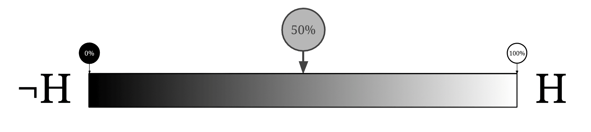
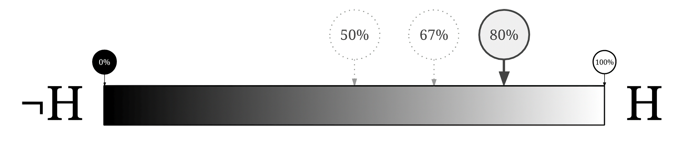
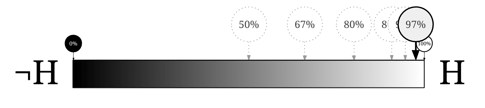
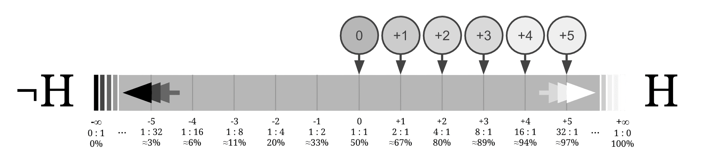

## Теорема Баєса: логарифмічна форма шансів

Форма Баєсової теореми у вигляді шансів твердить, що апріорні шанси, помножені на співвідношення правдоподібності, дорівнюють апостеріорним шансам. Візьмемо логарифм з обох сторін рівняння і отримаємо еквівалентне рівняння, в якому члени додаються, а не множаться.

Нехай $H_i$ та $H_j$ позначають гіпотези, а $e$ — свідчення, тоді логарифмічна форма Баєсової теореми у вигляді шансів виглядатиме так:

$$log(\frac{\mathbb{P}(H_i∣e)}{\mathbb{P}(H_j∣e)})=log(\frac{\mathbb{P}(H_i)}{\mathbb{P}(H_j)})+log(\frac{\mathbb{P}(e∣H_i)}{\mathbb{P}(e∣H_j)})$$.

Така форма може бути зручною, коли ви послідовно виконуєте багато оновлень. Але ще важливіший привід мислити у логарифмічних шансах — краще засвоїти «силу свідчення».

### Логарифми співвідношень правдоподібності

Скажімо, ви плануєте навідати своїх друзів — подружжя Ендрю та Бетті. Вони пообіцяли, що після вашого прильоту хтось із них забере вас з аеропорту. Ви не певні, хто саме (апріорні шанси $50:50$), але знаєте ось що:

1.   У них обох по машині — синя і червона. Ендрю надає перевагу синій, а Бетті — червоній, хоча кореляція відносно слабка. (Іноді їхній вибір залежить від того, на якій їздить їхня дитина.) Ендрю вдвічі частіше їздить на синій машині, ніж Бетті.
2.   Як правило, Бетті сигналить, щоб її помітили. Ендрю теж сигналить, але рідше. Бетті вчетверо ймовірніше буде сигналити, ніж Ендрю.
3.   Як правило, Ендрю запізнюється (частіше за Бетті). Імовірність того, що автомобіль Бетті вже буде в аеропорту до вашого прильоту, вдвічі вища.

Усі три спостереження незалежні, наскільки вам відомо (тобто ви не припускаєте, що Бетті приїде раніше чи пізніше, якщо поїде на синій автівці тощо).

Скажімо, ми бачимо синю автівку: вона вже стоїть біля аеропорту і сигналить.

Розрахунок у формі шансів виглядатиме так: апріорні шанси $1:1$ для «Бетті проти Ендрю» помножити на співвідношення правдоподібності $(1:2)×(4:1)×(2:1)$ дорівнює апостеріорним шансам $(1×4×2:2×1×1)=8:2=4:1$, тож імовірність 4/5 або 80%, що це Бетті.

Ось логарифмічна форма шансів тих самих розрахунків, де 1 **біт** позначає кожну двократну зміну у ступені переконаності або силі свідчення:

*   Апріорна віра в Бетті $log_2(\frac{1}{1})=0$ бітів.
*   Свідчення $log_2(\frac{1}{2}) = -1$ біт проти Бетті.
*   Свідчення $log_2(\frac{4}{1})= +2$ біти за Бетті.
*   Свідчення $log_2(\frac{2}{1})= +1$ біт за Бетті.
*   Апостеріорне переконання: $0+^{-}1+^{+}2+^{+}1=^{+}2$ біти за те, що нас підбере Бетті.

Якщо ваша апостеріорна віра дорівнює ${+}2$ біти, тоді апостеріорні шанси складають $2^{+2}:1=4:1$, що дає апостеріорну ймовірність 80%, що вас забере Бетті.

Свідчення і переконання, представлені у такому вигляді, просто *додаються одне до одного* (є адитивними), що краще підходить для інтуїтивного розуміння «сили переконаності» та «сили свідчення»; далі розглянемо цю думку детальніше.

### Вісь логарифмічних шансів

Нехай ви вважаєте, що гіпотеза $H$ настільки ж імовірна, як і $¬H$ (її заперечення). Тоді ви отримуєте п’ять окремих незалежних оновлень $2:1$ на користь $H$. Що стається з вашими ймовірностями?

Ваші шанси (для $H$) перетворюються таким ланцюжком: $1:1 → 2:1 → 4:1 → 8:1 → 16:1 → 32:1$.

Тож ваші ймовірності змінюються так: $\frac{1}{2}=50\% → \frac{2}{3}≈67\% → \frac{4}{5}=80\% → \frac{8}{9}≈89\% → \frac{16}{17}≈94\% → \frac{32}{33}≈97\%$.

Візуально представити ці зміни ймовірностей можна на осі від 0 до 1:

Ми спостерігаємо, що ймовірності наближаються до 1, але ніколи не досягають того краю: вони просто послідовно долають частини залишкової відстані, зрештою скупчуючись біля правого кінця.

А якщо перетворити ймовірності у логарифмічні шанси, ситуація стає куди кращою: ймовірності 50% відповідає 0 бітів переконаності, і кожне незалежне спостереження $2:1$ на користь $H$ посуває переконання на одну одиницю вздовж осі:

(Якщо вам цікаво, що відбувається, коли ми досягнемо кінця осі, то такого кінця не існує! 0% імовірності стає $-∞$ бітів переконаності, а 100% імовірності — $+∞$ бітів переконаності.)

### Інтуїції довкола осі логарифмічних шансів

Є кілька причин, чому ця нескінченна вісь логарифмічних шансів краще узгоджується з нашими інтуїціями про «переконання», ніж звичайний імовірнісний діапазон $[0;1]$. Наприклад:

*   Свідчення, що ви його побачите вдвічі ймовірніше, якщо гіпотеза істинна, — це $^{+}1$ біт свідчення і $^{+}1$ біт оновлення, незалежно від того, наскільки впевненим чи невпевненим ви були на початку — адже сила нового свідчення і відстань, на яку ми оновлюємо, не мають *залежати від* нашої апріорної віри.
*   Якщо ваша переконаність у чомусь становить 0 бітів — вона ні позитивна, ні негативна, — тоді ваша оцінка шансів становить $1:1$.
*   Відстань між 0,01 та 0,000001 набагато більша, ніж відстань між 0,11 та 0,100001.

Зупинімося на останньому пункті: на ймовірнісній осі 0–1 різниця між 0,01 (шанс 1%) та 0,000001 (шанс один на мільйон) згрубша та сама, що й відстань між 11% та 10%. Такий стан справ не узгоджується з нашим інтуїтивним відчуттям сили твердження: різниця між «1 на 100» та «1 на 1 000 000» (!) відчувається набагато істотніше, ніж різниця між «ймовірність 11%» та «ймовірність трохи більш як 10%».

На осі логарифмічних шансів переконаність «1 до 100» відповідає значенню $^{-}2$ порядки величини, а переконаність «1 до мільйона» — $^{-}6$ порядків величини. Між ними відстань у $^{-}4$ порядки величини: $log_{10}(10^{-6})-log_{10}(10^{-2})=^{-}4$ порядки або $^{-}13,3$ біта. З іншої сторони, від 11% до 10% — це $log_{10}(\frac{0,10}{0,90})-log_{10}(\frac{0,11}{0,89})≈-0,954-^{-}0,907≈^{-}0,046$ порядку величини або $^{-}0,153$ біти.

Вісь логарифмічних шансів не стискає величезні різниці на краях імовірнісного спектра. Натомість вона демонструє «шкалу переконаності», що нескінченно розширюється в обох напрямках: щоразу, коли ви бачите свідчення зі співвідношенням правдоподібності $2:1$, додається один біт переконаності.

Згідно з [законом Вебера — Фехнера](https://uk.wikipedia.org/wiki/Закон_Вебера_—_Фехнера), більшість людських чуттів логарифмічна за своєю природою: зміна інтенсивності у два рази *відчувається* як збільшення приблизно на ту ж величину, хай би де на шкалі ви стояли. Подвоєння фізичної інтенсивності звуку сприймається людиною приблизно як однакова зміна цього звуку, незалежно від того, чи початкова інтенсивність звуку становила 40 чи 60 децибелів. Саме тому й існує експоненціальна шкала інтенсивності звуку в децибелах![^1]
[^1]: На практиці логарифмічне сприйняття звуку означає, що малі зміни добре чутні на фоні тихих звуків (наприклад, шепіт краще розрізнити в порожній кімнаті), а великі зміни майже непомітні на фоні гучних (щоб перекричати рок-концерт і відчути бодай якесь посилення, потрібно колосально збільшити фізичну потужність звуку). Кожні +10&nbsp;дБ означають зростання фізичної енергії звуку у 10 разів, але суб’єктивно це сприймається приблизно як «удвічі гучніше» — звідси й логарифмічна шкала повзунків гучності в аудіоплеєрах, телефонах та мікшерних пультах: якби вона була лінійною, гучність зростала б надто різко на початку шкали і майже не змінювалася б наприкінці. — Прим. пер.

Тому логарифмічна форма шансів має бути в деякому сенсі *найбільш* інтуїтивним для використання варіантом Баєсової теореми: просто додайте силу свідчень до сили переконання (тобто, якщо зможете зробити свої суб’єктивні оцінки сили свідчення й сили переконання пропорційними логарифмам співвідношень).

Та й за допомогою логарифмічного представлення нам простіше побачити, як надзвичайні твердження потребують надзвичайно сильних свідчень: якщо ваша апріорна віра в $H$ становить -30 бітів і ви бачите свідчення порядку +5 бітів для $H$, тоді у вас буде -25 бітів віри в $H$, тобто ви все ще вірите, що гіпотеза менш імовірна за її альтернативи.

### Приклад: сині устриці

Розглянемо задачу із синіми устрицями. У Нанта́кеті ви збираєте екзотичні устриці. Там є дві різні затоки, де ви шукаєте устриці.

*   В обох затоках 11% зібраних устриць містять цінні перлини, тоді як 89% порожні.
*   У першій затоці 4% устриць із перлинами — сині, і 8% устриць без перлин теж сині.
*   У другій затоці 13% устриць з перлинами сині і 26% без перлин сині.

Ви б, скоріше, взяли синю устрицю з першої чи другої затоки? Для початку зауважимо, що співвідношення правдоподібності від «синьої устриці» до «устриці з перлиною проти устриці без перлини» становить $1:2$ в обох випадках, тому обидва види синіх устриць рівноцінні. (Задумайтеся на мить, наскільки це здавалося б неочевидним до того, як ви дізналися про Баєсову теорему!)

Але який шанс того, що (будь-який з видів) синя устриця ховає в собі перлину? Підказка: саме час перетворити вашу міру переконаності на біти (з основою 2).

> Відповідь
> 89% — приблизно у 8 разів більше, ніж 11%, тому починаємо з $^{-}3$ бітів віри, що у випадковій устриці є перлина.
>
> Імовірність того, що устриця з перлиною буде синьою, удвічі менша, ніж у порожньої, тому якщо устриця синя, ми отримуємо $^{-}1$ біт свідчення проти наявності перлини. Апостеріорна віра має дорівнювати $^{-}4$ бітам або шансам $1:16$ проти або ймовірності 1/17 (трохи більше за 5% (1/20)). Насправді — 5,88%.

### Приклад із життя: тест на ВІЛ

В одному дослідженні донорів крові з Китаю[^2] з’ясувалося, що приблизно 1 китайський донор на 100&nbsp;000 хворів на ВІЛ (значення встановлене дуже надійним тестом, що вважають золотим стандартом). Тести, які використовують для початкового обстеження і не є золотим стандартом, мали *чутливість* 99,7% та *специфічність* 99,8%, що, відповідно, означає $\mathbb{P}(позитивний|ВІЛ) = 0,997$ і $\mathbb{P}(негативний|¬ВІЛ) = 0,998$, тобто $\mathbb{P}(позитивний|¬ВІЛ) = 0,002$.
[^2]: Приклад суто навчальний і не пов’язаний з дійсними даними. — Прим. пер.

Маємо апріорні шанси $1:100\,000$ проти ВІЛ і позитивний результат початкового обстеження на користь ВІЛ зі співвідношенням правдоподібності $500:1$.

Застосуймо логарифм з основою 10 (так буде легше розв’язувати в голові):

*   Апріорна віра у наявність ВІЛ дорівнює близько -5 порядків.
*   Сила свідчення дорівнювала трохи менше за +3 порядки, оскільки 500 менше за 1000 ($log_{10}(500)≈2,7$).

Отже, апостеріорна віра у наявність ВІЛ трохи нижча за -2 порядки, тобто трохи менше, ніж шанс $1:100$ бути хворим на ВІЛ.

Навіть попри те, що співвідношення правдоподібності для цього обстеження становило $500:1$ на користь ВІЛ, не слід панікувати через позитивний результат!

Певна річ, у цьому дослідженні людей випадково обстежували у країні, де поширеність ВІЛ відносно низька. Для людей, які проходять тестування на ВІЛ через певні побоювання або в країнах із високим рівнем поширеності ВІЛ, потрібні окремі статистичні дані. *Менше з тим*, варто пам’ятати про такі міркування для багатьох хвороб $X$ і спостережень $Y$, як «лише невелика частина людей хвора на $X$» та «для попередніх спостережень $Y$ показники хибно позитивних результатів можуть виявитися *не настільки низькими*».

### Нескінченні оцінки ймовірності

Представлення у вигляді логарифмічних шансів показує, наскільки значення 0 та 1 є нетиповими у класичних імовірностях. Наприклад, якщо ви присвоїте гіпотезі ймовірність 0 або 1, жодні свідчення не змінять вашої думки.[^3]
[^3]: У статистиці [правило Кромвеля](https://defibering.wordpress.com/2023/01/20/scientific-method/#_18._Правило_Кромвеля) стверджує, що емпіричним твердженням не слід присвоювати ймовірність строго 0 або 1, адже завжди існує ймовірність помилитися. — Прим. пер.

На осі логарифмічних шансів рівні переконаності коливаються від $-∞$ до $+∞$, де нескінченні крайні значення відповідають 0 та 1, які можна розглядати як «нескінченні значення переконаності». Не означає, що 0 та 1 взагалі не допускаються. Раціональний агент виходить з того, що $\mathbb{P}(X)+\mathbb{P}(¬X)$ має дорівнювати 1 (де $¬X$ — логічне заперечення $X$).[^4] У будь-якому разі ці крайні значення нескінченної переконаності поводяться як «особливі об’єкти», а на звичайному спектрі у них якісно інакша поведінка. Такі твердження, як «Після побаченого сильного свідчення моє переконання ніколи не має бути точно таким, яким було», хибні у випадку крайніх значень переконаності, як і «Віднімання 1 від числа дає менше число» хибне, якщо ви наполягаєте на тому, щоб розглядати нескінченність як число.
[^4]: Нам, простим смертним, краще уникати крайніх імовірностей навіть тоді. — Прим. авт.

### Свідчення у децибелах

Едвін Джейнз у своїй праці «Теорія ймовірностей: логіка науки»[^5] (секція 4.2) пише, що людям легше зрозуміти і використовувати свідчення у децибелах.
[^5]: Jaynes, E. T. *[Probability Theory: The Logic of Science](https://archive.org/details/probabilitytheor0000jayn)*. Edited by G. Larry Bretthorst, Cambridge University Press, 2003.

Якщо гіпотеза має співвідношення правдоподібності $o$, тоді його значення у децибелах вираховується формулою $e=10log_{10}(o)$.

У цій схемі помножити співвідношення правдоподібності на 2 — означає додати приблизно 3&nbsp;дБ. Помножити на 10 — додати 10&nbsp;дБ.

Джейнз пише, що через простоту обчислень спочатку використовували десяткові логарифми, а з появою кишенькових калькуляторів намагалися перейти до натуральних логарифмів. Але, як виявилося, легше зрозуміти саме десяткові.

