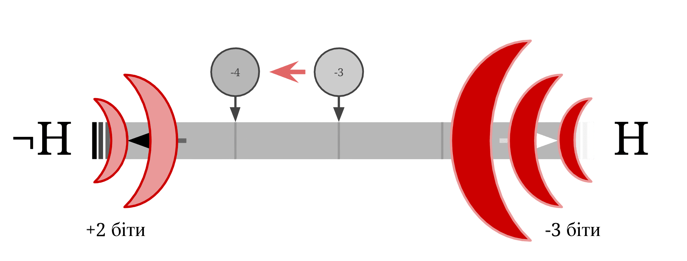

## Рухайтеся до найменш неочікуваної гіпотези

Логарифмічна форма шансів Баєсової теореми стверджує: як силу віри, так і силу свідчення можна виміряти в бітах. Цими бітами свідчення так само можна міряти величину під назвою «баєсівське здивування», що дає ще один спосіб інтуїтивно зрозуміти теорему Баєса.

Грубо кажучи, ми можемо оцінити, наскільки гіпотеза $H_i$ дивується свідченням $e$, визначивши, яку частку ймовірнісної маси гіпотеза надала спостереженню $e$. Якщо гіпотеза $H_i$ приписала свідченню $e$ 100% своєї ймовірнісної маси, тоді свідчення $e$ є для $H_i$ цілком очікуваним. Якщо ж гіпотеза $H_i$ приписала свідченню $e$ 0% своєї ймовірнісної маси, тоді свідчення $e$ є для $H_i$ *максимально неочікуваним*. Будь-яку міру $\mathbb{P}(e|H_i)$ — тобто ймовірність, яку гіпотеза $H_i$ приписує свідченню $e$, що має цю властивість, можна назвати «здивуванням». Баєсове здивування визначається як $-log(\mathbb{P}(e|H_i))$ — величина, що підпорядковується цим інтуїтивним обмеженням і має деякі інші цікаві властивості.

Повернімося до задачі із синіми устрицями. Відповідно, згадаємо і гіпотези $H$ — устриця з перлиною — та $¬H$ — устриця без перлини. Не будемо ускладнювати собі задачу і припустимо, що ми збираємо устриці вже з третьої затоки, де $\frac{1}{8}$ устриць — ті, що з перлиною, і $\frac{1}{4}$ тих, що без неї, — сині.

Нехай ви знайдете синю устрицю. Гіпотеза $H$ передбачала синій колір у кожної восьмої устриці, тоді як гіпотеза $¬H$ — у кожної чверті устриць. Отже, для конкретного спостереження $e$ гіпотеза $¬H$ зробила краще передбачення, оскільки приписала йому вищу ймовірність. Раніше ми сполучали $\mathbb{P}(e∣H)$ та $\mathbb{P}(e∣¬H)$ в об’єднані співвідношення правдоподібності $\frac{1}{8}:\frac{1}{4}=1:2$, тобто спостереження ознаки «синій колір» дає 1 біт свідчення для віри в $H$. А ми ще можемо спершу узяти логарифм, а потім сполучити.

Оскільки $H$ приписала тільки восьму частину своєї ймовірнісної маси спостереженню ознаки «синій колір», а баєсівське оновлення працює за принципом усунення тієї частини маси, яка відповідає результатам, несумісним з отриманим свідченням, ми маємо змістити нашу віру в $H$ на $log_2(\frac{1}{8})=-3$ біти від віри в гіпотезу $H$ до $¬H$. (Кожен негативний біт означає «викинути половину ймовірнісної маси $H$». А в нашому випадку слід зробити так тричі, щоб виключити те, що $H$ не приписала спостереженню $e$ жодної ймовірності.)

Схожим чином, оскільки гіпотеза $¬H$ приписала лише чверть своєї ймовірнісної маси спостереженню ознаки «синій колір», ми маємо скоригувати нашу віру в $H$ на $-log_2(\frac{1}{4})=-2$ біти від $¬H$.

Отже, коли отримуємо спостереження ознаки «синій колір», ми посуваємо нашу віру (виміряну в бітах) на 3 поділки від $H$, потім — на 2 поділки у бік $H$. У підсумку наша віра посувається на 1 поділку від $H$.

*$H$ приписала $\frac{1}{8}$ своєї ймовірнісної маси до спостереження ознаки «синій колір», тому вона видає $−log_2(\frac{1}{8})=3$ біти здивування, якщо спостереження зсувається від $H$. $¬H$ приписала $\frac{1}{4}$ своєї ймовірнісної маси до спостереження, тому вона видає $−log_2(\frac{1}{4})=2$ біти здивування, якщо спостереження відходитиме від $¬H$ (до $H$). Загалом, віра в $H$ рухається на 1 біт у бік $¬H$.*

Якби $H$ натомість передбачала ознаку «синій колір» з імовірністю 4% (штраф $log_2(0,04)≈−4,64$), а $¬H$ — з імовірністю 8% (штраф $log_2(0,08)≈−3,64$), тоді ми мали б посунути на трохи більше як 4,6 поділки до $¬H$ і трохи більше як на 3,6 поділки до $H$, але *сумарно* ми б отримали той самий зсув. Ось чому важлива лише відносна різниця між кількістю бітів, на яку зменшується віра в $H$, і кількістю бітів, на яку зменшується віра в $¬H$.

У загальних рисах, за умови спостереження $e$ і гіпотези $H$, число бітів, які нам потрібно змістити від нашої віри в $H$, дорівнює $log_2(P(e∣H))$ — логарифму ймовірності того, що $H$ приписала до $e$. Ця кількість ніколи не додатна, оскільки логарифм $x$ для $0≤x≤1$ належить діапазону $[−∞;0]$[^1]. Якщо змінити їхній знак на протилежний, ми отримаємо невід’ємну величину, що пов’язує $H$ з $e$, яка дорівнює нулю, коли гіпотеза $H$ надавала цілковиту певність, що $e$ станеться, і нескінченності, коли $H$ надавала цілковиту певність, що $e$ не станеться, а вимірюється в тих самих одиницях, що й свідчення і переконання. Отже, цю величину часто називають «здивуванням», і от, власне, вона вимірює, наскільки гіпотеза $H$ була здивована (у бітах) свідченням $e$.
[^1]: Ідеться про діапазон $[0;1]$, адже $log(0)=−∞$, $log(1)=0$. Тому в цьому випадку діє розширена система чисел, в якій існує опція нескінченно великого свідчення від настання майже неймовірної події (з $\mathbb{P}=0$). — Прим. пер.

Між баєсівським здивуванням і людським відчуттям здивованості (наприклад, коли побачила щось, що, на її думку, було малоймовірним) є деякий взаємозв’язок, але, певна річ, формальне баєсівське здивування і людське емоційне здивування — зовсім різні речі. (Людина може почуватися здивованою і з інших причин, до яких не входить «мої гіпотези не передбачили даних». А ще — люди добре вміють нехтувати свідченнями замість того, щоб відчути здивування.)

З огляду на наведене визначення баєсівського здивування, ми можемо розглядати теорему Баєса як твердження, що *здивування відштовхує віру*. Коли ви помічаєте якесь $e$, здивування діє як сигнал, що відштовхує віру від гіпотези. Повернімося до наведеного вище зображення: коли $H$ передбачає ваше спостереження з імовірнісною масою $\frac{1}{8}$, а $¬H$ — з імовірнісною масою $\frac{1}{4}$, можна уявити, що $H$ випромінює сигнал здивування силою 3 біти, що відштовхують нашу віру від $H$, тоді як $¬H$ випромінює сигнал силою 2 біти, що відштовхують нашу віру від $¬H$. Обидва сигнали посувають віру в $H$ у різних напрямках, і все закінчується тим, що ви на 1 біт ближче до $¬H$ (що випромінювала слабший сигнал здивування).

Іншими словами, щоразу, коли ви дивуєтеся якійсь події чи спостереженню, думайте про *пояснення, що має найменше значення баєсівського здивування* для цього свідчення, а потім додайте цій гіпотезі кілька бітів віри.