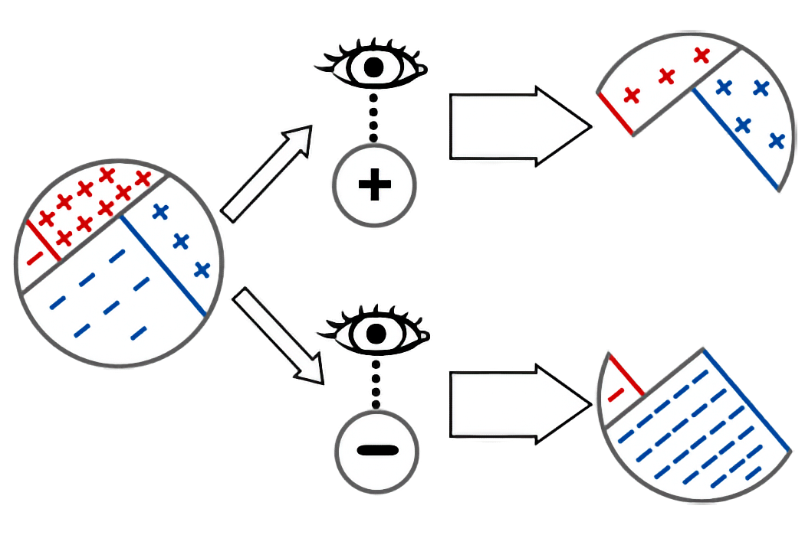

## Перегляд переконань як вилучення ймовірнісної маси

Механізм дії теореми Баєса можна зрозуміти, зокрема, і через процес оновлення $\mathbb{P}$ на підставі нових свідчень, котрий можна тлумачити як вилучення ймовірнісної маси з $\mathbb{P}$ (точніше, всю ймовірнісну масу, що суперечить свідченням).

Як приклад використаємо вже відому задачу про дисизіт:

> «Ви обстежуєте якусь множину пацієнтів на наявність хвороби, яку ми назвемо дисизітом. Ви очікуєте, що на дисизіт захворіє близько 20% пацієнтів з обстеженої сукупності. Ви проводите тестування на наявність хвороби за допомогою язикової лопатки із чутливою хімічною смужкою. У 90% пацієнтів, хворих на дисизіт, ця лопатка забарвлюється у чорний колір. Але з тим ця лопатка чорніє і в 30% пацієнтів без дисизіту. До вас у кабінет заходить ваш пацієнт, проходить тестування — його лопатка чорніє. Маючи лише цю інформацію, порахуйте ймовірність того, що у вашого пацієнта дисизіт».

У цій ситуації з одним-єдиним пацієнтом до розгляду яких-небудь свідчень ми можемо перебувати в чотирьох можливих світах:

|  | $Здоровий$ | $Хворий$ |
| --- | --- | --- |
| $Тест+$ | $18\%$ | $24\%$ |
| $Тест-$ | $2\%$ | $56\%$ |

*Спостерігати*, що пацієнт отримує позитивний результат, — означає вилучити з подальшого розгляду можливі світи, де пацієнт отримує негативний результат, і навпаки:

Отже, теорема Баєса стверджує ось що: щоб оновити свої переконання на підставі свідчень, просто відкиньте ймовірнісну масу, що суперечить отриманим свідченням.

### Приклад: Задача зі шкарпетками та комодом

Усвідомити, що *спостереження свідчення* відповідає *вилученню ймовірнісної маси*, і зосереджуватися лише на залишковій ймовірнісній масі — ключ до розв’язку задачі пошуку шкарпеток у комоді:

> «Ви кинули свої шкарпетки десь у кімнаті. Вам здається, що шанси того, що ви закинули їх у якусь випадкову шухляду свого комода, становлять $⅘$, тому беретеся шукати свої шкарпетки по тих 8 шухлядах комода. Переривши 6 випадкових шухляд, ви так і не знайшли ні одної шкарпетки. Яка ймовірність того, що ви нариєте шкарпетки у наступній шухляді?».

(За бажанням можете розв’язати задачу, перш ніж читати далі.)

> Відповідь:
> Спочатку у нас є 20% від імовірнісної маси того, що «шкарпетки не в комоді» і 80% від імовірнісної маси того, що «шкарпетки в комоді». Кожним вісьмом шухлядам відповідають 10% ймовірнісної маси (позаяк ймовірність для кожної з восьми шухляд однакова).
> Вилучивши ймовірнісну масу з 6 шухляд, ми лишаємося з 40% від початкової маси: 20% на те, що «шкарпетки не в комоді», і по 10% на решту непроглянутих шухляд.
> Оскільки ті залишкові 40% імовірнісної маси — все, що ми маємо, ми розширюємо наш розподіл імовірностей до 100%, тобто ренормалізуємо розподіл імовірностей. Всередині наших залишкових 40% від апріорної ймовірнісної маси половина (початкові 20%) припадає на гіпотезу «не в комоді» і по чверті (початкові 10%) — на ті дві шухляди.
> Отже, ймовірність знайти свої шкарпетки у наступній шухляді становить 25%.
> Якщо вам хочеться більш соковитих прикладів застосування методу Баєса, киньте оком на есей «[Злети й падіння функції надії в безплідних пошуках](https://gwern.net/doc/statistics/bayes/hope-function/1994-falk)».

### Розширення суб’єктивної ймовірності

У парадигмі баєсіанства такий підхід *оновлення переконання через обумовлення ймовірнісного розподілу свідченнями* дієвий як у випадках наявності даних про статистичні сукупності з об’єктивними частотностями, що відповідають імовірностям, *так і* в випадках, коли наша невизначеність *суб’єктивна*.

Уявіть себе королем, який думає про непересічну дивачку: ви надаєте близько 20% імовірності, що вона найманий убивця. З цього не випливає, що є сукупність схожих людей, з яких 20% вбивають за гроші. Це означає, що ви зважили свою невизначеність і здогадки та вирішили ставити на те, що ваша підозрювана — найманий убивця, зі співвідношенням $1:4$.

Тоді ви думаєте так: якщо ця дивачка — найманий убивця, з імовірністю 90% вона має при собі кинджал (так ви міряєте власну суб’єктивну невизначеність); якщо ви уявляєте її найманою убивцею, прийнятною ставкою вам здаються шанси $9:1$, що у неї є кинджал. Якщо ця конкретна дивачка не виявиться найманою вбивцею, ваше враження про наявність у неї кинджала становитиме близько 30%.

Коли ваша варта оглядає її і знаходить кинджал, тоді, на думку баєсіанців, ви маєте оновити свої переконання так само, як оновлюєте їх у випадку з дисизітом — де йдеться про велику статистичну сукупність з об’єктивною частотністю захворювання, — попри те, що цей гаданий убивця — унікальний випадок. Якщо вірити баєсіанцям, ваш мозок може відстежувати ймовірності різних можливостей, незалежно від наявності великих статистичних сукупностей та об’єктивних частотностей. Тож коли ви оновлюєте свої переконання за допомогою свідчень, ви не «усуваєте людей з розгляду» — ви вилучаєте *ймовірнісну масу* з конкретних *можливих світів*, представлених у вашому суб’єктивному стані переконань.
