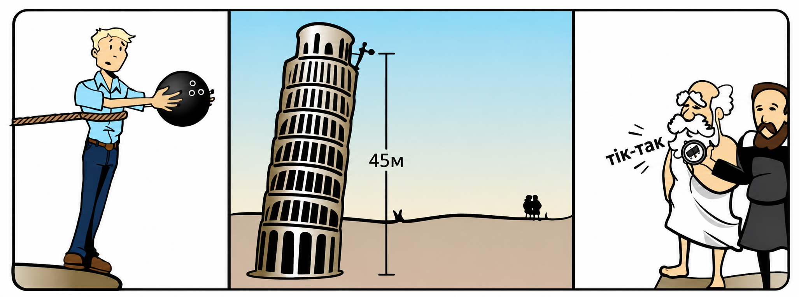
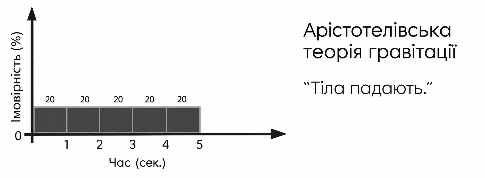
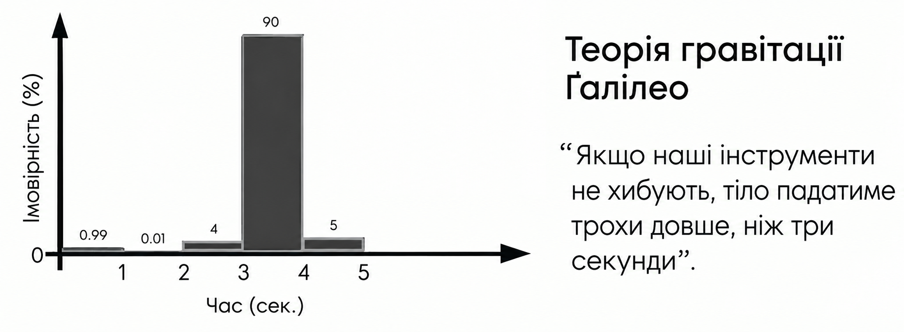

## Баєсівський погляд на наукові чесноти

Через теорему Баєса можна інтуїтивно пояснити низку наукових чеснот, зокрема:

*   **спростовність**: доброчесний науковець має сказати, чого він *не* очікує побачити, якщо теорія істинна;
*   **сміливість**: влучна теорія продукує сміливі експериментальні прогнози (яких ми б не очікували за інших обставин);
*   **точність**: влучна теорія продукує точні експериментальні прогнози (які виявляються правильними);
*   **фальсифікаціонізм**: наукова теорія завжди приймається попередньо, а відкидається ж доволі остаточно;
*   **експериментування**: збираючи спостереження, ви знаходите кращі теорії, а потім оновлюєте свої переконання.

### Спростовність

«Спростовність» означає, що можна вказати, які події та спостереження точно *не* мають відбуватися, якщо теорія істинна.

Уперше цю наукову чесноту популяризував Карл Поппер, який у своїй відомій критиці фройдівського психоаналізу написав таке:

> «Ані Фройд, ані Адлер не виключають того, що конкретна людина може поводитися певним чином, незалежно від зовнішніх обставин. Чи то чоловік пожертвував своїм життям для порятунку дитини від утоплення (випадок сублімації), чи то він убив дитину, втопивши її (випадок витіснення), — обидва випадки не можна ні передбачити, ні виключити фройдівською теорією; *теорія просто узгоджувалася з усім, що могло статися*»[^1].

[^1]: Уривок з Popper, K. (1985). [The problem of demarcation](https://todayinsci.com/P/Popper_Karl/PopperKarl-Truth-Quotations.htm
). In D. Miller (Ed.), *Popper selections* (pp. 127–128). Princeton University Press.

У рамках баєсіанства спростовність гіпотези ми розглядаємо як вимогу для отримання сильних співвідношень правдоподібності на підтримку гіпотези порівняно з альтернативною, наприклад: «Я не знаю».

Уявіть себе дуже раннім дослідником гравітації на ім’я Ґрек. Ваш друг Таґ тримає в руці камінь, а потім кидає його. Вам треба передбачити, чи той камінь впаде на землю, полетить у небо чи зробить щось інше. Тобто ви маєте сказати, як ваша теорія *Ґрек* приписує ймовірності варіантам «вниз», «вгору» чи «щось інше».

Так сталося, що у вашого друга є своя теорія *Таґ*, згідно з якою «камені роблять те, що хочуть». Якщо Таґ бачить, як камінь падає, він пояснить це спостереження бажанням каменя впасти. Таґ бачить, як камінь рухається вгору, — каже, що камінь хоче полетіти. Таґ думає, що Таґова теорія гравітації дуже вдала, бо нею можна пояснити будь-яку можливу поведінку каменя, яку ми спостерігаємо. Ця особливість робить її кращою за теорію, якою можна пояснити *лише*, скажімо, падіння каменя.

Але Ґрек — баєсіанка і чудово розуміє, що «вниз», «вгору» та «щось інше» — взаємовиключні й вичерпні можливості всередині системи і що *щось* точно має відбутися, коли Таґ дозволяє каменю впасти, — умовні ймовірності $\mathbb{P}(⋅\mid\text{теорія Таґа})$ мусять зводитися до $\mathbb{P}(\text{вгору}\mid\text{теорія Таґа})+\mathbb{P}(\text{вниз}\mid\text{теорія Таґа})+\mathbb{P}(\text{інше}\mid\text{теорія Таґа})=1$.

Якщо Таґ «однаково добре пояснює» всі три результати — якщо Таґова теорія однаково узгоджується з усіма трьома подіями і видає однаково розумні пояснення для кожного з них, — тоді ми так само можемо сказати, що кожна $\mathbb{P}(\text{вгору}\mid\text{теорія Таґа})$, $\mathbb{P}(\text{вниз}\mid\text{теорія Таґа})$ та $\mathbb{P}(\text{інше}\mid\text{теорія Таґа})$ дорівнює $1/3$. Зауважте, що Таґова теорія (в імовірнісному сенсі) нічим не відрізняється від «Я не знаю».

А тепер уявімо, що Ґрек висуває спростовне передбачення!

Вона каже: «Більшість тіл падає вниз!». Тоді у Ґрек не вся ймовірнісна маса розподілена рівномірно! Ґрек поклала 95% від імовірнісної маси на $\mathbb{P}(\text{вниз}\mid\text{теорія Ґрек})$! І лише 5% рівно розподілила між $\mathbb{P}(\text{вгору}\mid\text{теорія Ґрек})$ та $\mathbb{P}(\text{інше}\mid\text{теорія Ґрек})$ — у тому випадку, якщо камінь пташкою пурхне в небо. Таґ відказує, що це погана ідея. Якщо раптом камінь полетить вгору, теорія гравітації Ґрек спростується хибним передбаченням! Інше діло — Таґова теорія, що прогнозує шанс $1/3$: співвідношення правдоподібності буде $2,5\%:33\% ≈1:13$ проти теорії Ґрек! Тепер Ґрек спантеличена!

Ґрек каже: вона впевнена, що камінь *впаде вниз*. І птахів куди менше. Тому вона готова ризикнути репутацією і наразитися на можливу помилку. Крім того, набагато важливіше не зберегти лице, а дізнатися, чи теорія Ґрек істинна.

Випускаємо з рук камінь. Камінь падає вниз.

Отримане свідчення має співвідношення правдоподібностей $0,95:0,33≈3:1$ на користь теорії Ґрек порівняно з теорією Таґа.

— Як ти отримала таке велике співвідношення правдоподібності? — питає Таґ. — Таґ ніколи не отримував настільки велике співвідношення!

Ґрек пояснює, що вона змогла отримати велике співвідношення правдоподібності, бо піддала ризику свою теорію і *забрала* частину ймовірнісної маси від результатів «вгору» і «щось інше» (якщо щось із цього таки станеться, її теорія буде спростована). Так Ґрек звільняє чималу ймовірнісну масу, яку вона може покласти на результат, що дає велике співвідношення правдоподібності, якщо камінь таки впаде.

Теорія Ґрек виграє́, бо вона спростовна і видає коректне передбачення! Якби вона була спростовною і видавала хибне передбачення, то програла б. Але в цьому немає нічого поганого, адже теорія Ґрек — не сама Ґрек.

#### Спершу передбачення

У наступному експерименті Таґ випускає камінь з рук, дивиться, як той падає, і каже: «Таґова теорія приписує $\mathbb{P}(\text{вниз}\mid\text{теорія Таґа})$ 100%».

— Ґрек думає, — відповідає вона, — якби Таґ побачив, як камінь натомість злітає вгору, він би сказав, що $\mathbb{P}(\text{вгору}\mid\text{теорія Таґа})$. Таґ вразливий до упередження заднім числом.

— Ґрек не може довести, що Таґ упереджений, — відказує Таґ, — Ґрек переходить на особистості.

— Нове правило, — каже Ґрек, — усі *заздалегідь* оголошують свої оцінки ймовірностей. А потім вже нема сенсу обговорювати.

Таґ думає:

— Таґ каже $\mathbb{P}(\text{вгору}\mid\text{теорія Таґа})=1$ і $\mathbb{P}(\text{вниз}\mid\text{теорія Таґа})=1$.

— Таґ порушує аксіоми теорії ймовірностей, — каже Ґрек, — ймовірність усіх взаємовиключних результатів мусить дорівнювати одиниці або меншому значенню. Але добре, що Таґ сказав це зараз і Ґрек бачить проблему.

— Так нечесно! — заперечує Таґ. — Має бути дозволено оголошувати оцінки після події — тоді ніхто не зможе довести, що я помилився!

#### Формальність

Правило «спершу передбачення» набагато важливіше у прагматичному плані для неформальних теорій, аніж для формальних; у цьому контексті теорія вважається «формальною», якщо її передбачення формуються настільки механічно й однозначно, що будь-хто може ввести її в комп’ютер і отримати той самий результат у ймовірностях, який припускає ця теорія.

Коли Ньютон запропонував свою теорію гравітації, її вважали ще не до кінця доведеною, позаяк такі ретропрогнози (передбачення вже відомих результатів), як припливи, еліптичні орбіти планет і [закони Ке́плера](https://uk.wikipedia.org/wiki/Закони_Кеплера)[^2], вже можна було спостерігати ще *до* Ньютона.
[^2]: Три закони, сформульовані Йоганном Кеплером, що описують форму планетних орбіт, зміну швидкості руху планет та зв’язок між розміром орбіти й періодом обертання. В цьому прикладі закони Кеплера є раніше відомими спостережуваними закономірностями, які Ньютонова теорія могла пояснити та вивести з більш загальних принципів. — Прим. пер.

Навіть у такому випадку баєсіанець надав би Ньютоновій теорії значну вагу завдяки цим ретропрогнозам, бо, на відміну, скажімо, від психологічної теорії людської поведінки, будь-хто — а не тільки Ньютон — міг узяти олівець і вивести точно такі ж передбачення з Ньютонових законів. Не можна повністю виключати ту можливість, що Ньютонову теорію в якомусь сенсі надміру підлаштували під закони Кеплера і дані про припливи, внаслідок чого вона не здатна буде давати нові коректні передбачення. Але менше практичних підстав побоюватися, що Тагтон просто скаже: «Ну, звичайно ж, моя теорія "Планети рухаються, куди хочуть" передбачала б еліптичні орбіти; еліптичні орбіти виглядають класно».

#### Запитати послідовників теорії, що вона стверджує

Таґ піднімає ще один камінь:

— Я наперед кажу, що теорія Ґрек приписує ймовірність 0%, що камінь впаде, — Таґ спростовує теорію Ґрек!

Ґрек хитає головою:

— Треба запитати пропонентів теорії Ґрек, що вона передбачає, — Ґрек піднімає інший камінь. — Я кажу, що теорія Ґрек приписує $\mathbb{P}(\text{вниз}\mid\text{теорія Ґрек})=0,95$.

— А я кажу, теорія Ґрек стверджує $\mathbb{P}(\text{вниз}\mid\text{теорія Ґрек})=0$, — заперечує Таґ.

— Наука так не працює, — відповідає Ґрек, — Таґ має сказати, що стверджує Таґова теорія.

На мить Таґ задумується:

— За теорією Таґа, камінь впаде вниз з імовірністю 95%.

— Що? — дивується Ґрек. — Таґ просто бере теорію Ґрек! І Таґ казав не це *до того*, як побачив падіння каменя!

Таґ лукаво хмилиться:

— Тільки ж Таґ має сказати, що передбачає його теорія. Правда ж?

Знову ж — з практичних цілей *спершу* нам слід запитати послідовників неформальної теорії, що ця теорія передбачає (формальну теорію може застосувати будь-хто; якщо це не так, «формальною» її назвати не випадає).

Більше того, з тієї причини, що будь-який дурень може слідувати будь-якій справі, вам слід запитати найрозумніших та найбільш технічно підкованих пропонентів цієї теорії. Якщо виникає спір щодо того, кого таким вважати, запитайте окремо представників цієї спільноти, котрі вважаються найкомпетентнішими. Слава — точно не основний маркер: питання з квантової механіки слід ставити [Мюррею Ґелл-Манну](https://uk.wikipedia.org/wiki/Маррі_Гелл-Манн), а не [Діпаку Чопрі](https://nashformat.ua/authors/dipak-chopra-books), навіть якщо більше людей чули думки другого, а не першого. Якщо ви справді не можете провести різницю між ними, запитайте їх обох — не питайте лише Чопру, щоб потім сказати, що Чопра і є *тим* представником, бо про нього всі кажуть.

У такого роду реверансах не було б потреби, якби у нас був досить розвинений штучний інтелект чи досконалий раціональний агент, проте у людському наукотворенні, де люди можуть бути вмотивовані хибно трактувати ймовірнісні оцінки іншої теорії, такі правила мають сенс.

У цього неформального правила є обмеження, і можуть бути випадки, коли здається очевидним, що передбачення гіпотези не збігаються із заявами її послідовників або вони просто крадуть передбачення більш вдалої теорії. Але мусить існувати *значна* (хоча може бути скасована за наявності підстав) презумпція на користь того, щоб прихильники теорії могли висловлювати те, що, згідно з цією теорією, має відбутися.

### Сміливість

Через кілька хвилин Ґрек піднімає ще один камінь:

— $\mathbb{P}(\text{вниз}\mid\text{теорія Ґрек})=0,95$.

— $\mathbb{P}(\text{вниз}\mid\text{теорія Таґа})=0,95$, — каже він, — бачиш: Таґ приписує вищу ймовірність спостереженим результатам. Таґ виграє?

— Ні, — відповідає Ґрек, — співвідношення правдоподібності $1:1$ тепер весь час, навіть якщо ми віримо Таґу. Таґова теорія не отримує переваги. Таґу треба висловити *сміливе* передбачення, якого не роблять інші теорії.

Таґ насуплює брови:

— Таґ каже... камінь стане синім, коли ти випустиш його з рук? $\mathbb{P}(\text{синій}\mid\text{теорія Таґа})=0,9$.

— Дуже сміливо, — сказала Ґрек, — теорія Ґрек не стверджує такого (ані якийсь очевидний «здоровий глузд», ані теорії «як зазвичай»). Ґрек вважає, що $\mathbb{P}(\text{синій}\mid\text{¬ теорія Таґа})<0,01$, тому Таґове передбачення точно можна назвати сміливим. Якщо воно справдиться, ця подія буде справді вагомою.

$\frac{\mathbb{P}(\text{теорія Таґа}\mid\text{синій})}{\mathbb{P}(\text{¬теорія Таґа}\mid\text{синій})}>90×\frac{\mathbb{P}(\text{теорія Таґа})}{\mathbb{P}(\text{¬ теорія Таґа})}$

— Тепер Таґ виграв? — питає він.

Ґрек випускає камінь. Падає на землю. Не стає синім.

— Сміливе передбачення хибне, — відповідає Ґрек, — Таґове передбачення доброчесне, але не перемагає. Тепер Таґ програє співвідношення правдоподібності $1:10$. Ось тобі наука, ось тобі спростовність.

— Ґрек заманює Таґа в пастку! — обурюється Таґ.

— Дивись, — каже Ґрек, — вся заковика у тому, щоб встановити правила, за яких перемагають *правильні* теорії. Якщо конструктори хибних теорій, намагаючись поводитися як доброчесні науковці, швидко програють, це перевага — не вада. Але якщо Таґ пробує бути доброчесним і програє, ми тиснемо руки, і Таґ все ще виглядає добре. Зрештою, таким і має бути нормативний соціальний ідеал.

### Точність

На якомусь пізнішому щаблі розвитку теорії гравітації арістотелівський синтез теорій Ґрек і Таґа — «Більшість тіл мають кінцевий пункт призначення — центр Землі — і намагаються досягти його» — вступає у двобій з теорією Ґалілео Ґалілея — «Більшість тіл у вільному падінні прискорюються вниз, і з кожною секундою швидкість тіла збільшується на 9,8 м/с; не питайте чому — кажу, що бачу».

— Ти ж лише передбачаєш те, що і так видно: якщо камінь упустити, він падатиме вниз, — каже Арістотель, — я ж уже це передбачив.

— Наступним кроком, — починає Ґалілео, — ми передбачаємо, *як довго* куля для боулінгу падає з Пізанської вежі. — Ґалілео дістає з кишені секундомір: — Щойно мій друг скине кулю, ти тиснеш кнопку пуску, а як куля досягне землі, тиснеш кнопку зупинки. І ми подивимося, які саме числа покаже нам секундомір.

Після додаткової перевірки, чи в Арістотеля стабільний час реакції на натискання кнопки на секундомірі, коли Ґалілей клацає пальцями, Арістотель піднімає погляд на кулю, яку тримають на вершечку Пізанської вежі.

— Думаю, куля для боулінгу буде падати від 0 до 5 секунд включно, — прогнозує Арістотель, — а далі вже не впевнений.

— Гаразд, — відповідає Ґалілео, — я поміряв висоту вежі — 45&nbsp;метрів. Отже, якщо опір повітря дорівнює нулю, після 3 секунд куля має падати зі швидкістю $9,8×3=29,4\text{ м/с}$. Ця швидкість безперервно зростає протягом цих трьох секунд, тож *середня* швидкість кулі становить $29,4/2=14,7\text{ м/с}$. А якщо за три секунди куля рухається із середньою швидкістю 14,7&nbsp;м/с, вона подолає шлях униз на 44,1&nbsp;метра. Отже, куля падатиме трохи довше, ніж три секунди, щоб подолати шлях у 45&nbsp;метрів. Щось близько до додаткових 1/29&nbsp;секунди.

— Хммм, — задумується Арістотель. — Твій кишеньковий годинник вимірює час у секундах. Тож твоя теорія вкладає усю ймовірнісну масу у три секунди. Правильно?.

— Не прямо *всю* масу, — відказує Ґалілео, — ще проходить якийсь час перед тим, як ти побачиш падіння кулі й натиснеш кнопку пуску, а ще ж якийсь час мине між вдарянням кулі об землю і натисканням кнопки зупинки. *Здебільшого* ці два джерела похибок у вимірюваннях мають компенсуватися, але, може, саме в цьому випадку так не буде. У нас тут немає достатньо точної й добре перевіреної постановки експерименту. Тобто, якщо секундомір зламається і ми побачимо «0» на циферблаті, теорія гравітації Ґалілео зазнає *поразки*, але *остаточного* спростування чекати не варто — можна роздобути іншого годинника, сформулювати краще передбачення і надолужити цю поразку наступними результатами.

— Гаразд. Які ймовірності тоді приписує твоя теорія? — питає Арістотель. — Гадаю, моя теорія приблизно однаково добре пояснює будь-який час падіння від 0 до 5 секунд.

Ґалілео роздумує:

— Оскільки ми ще не тестували таку постановку... Думаю, поставлю десь 90% моєї ймовірнісної маси на те, що час падіння буде між 3 і 4 секундами, що відповідає спостережуваному результату на годиннику, що показує «3». Може, покладу ще 5% імовірності на опір повітря, що може мати відчутніший ефект, ніж мені здається, на цій дистанції, тому між 4 і 5 секундами, якщо циферблат покаже «4». І ще 4% на те, що годинник повільніший, ніж я думав, тому 4% ставлю на те, що час буде між 2 і 3, а секундомір покаже «2». І дам 0,99% ймовірності того, що годинник зламається і покаже «1» (або «0», але ми обоє погодилися, що такого не станеться), і 0,01% на те, що я побачу «2», чого взагалі-то не має статися, як я думаю.

— Що ж, — каже Арістотель, — безперечно, у твоєї теорії є наукова чеснота *точності*: зосереджуючи більшу частину ймовірності у вузькому діапазоні можливих точних спостережень, ви заробляєте своїй теорії вищу правдоподібність, що дає перевагу над *розпливчастішими* теоріями, як моя, яка стверджує лише «падіння тіл» і дає «справджене передбачення» щоразу, коли тіла падають вниз, але не передбачає, як довго вони будуть падати. Якщо твоє передбачення «3» справдиться, співвідношення правдоподібності становитиме $0,9 : 0,2$ або $4,5 : 1$ на користь теорії Ґалілео проти теорії Арістотеля.

— Саме так, — підтверджує Ґалілео, — певна річ, передбачення має бути не лише точним, а й правильним. Якщо годинник натомість показує «4», співвідношення правдоподібності становитиме $0,05:0,2$ або $1:4$ проти моєї теорії. Краще висунути розпливчасту й правильну теорію, ніж точну й помилкову.

Арістотель киває:

— Тоді до експерименту.

Боулінгову кулю кинуто.

Секундомір показує 3 секунди.

— То тепер ти віриш моїй теорії? — питає Ґалілео.

— Ну, я вірю їй десь у 4,5 раза більше, ніж до цього, — відказує Арістотель. — Але та частина, де ти підставляєш числа штибу «9,8» і всі ті обрахунки типу піднесення часу до *квадрата*, здається мені складнуватою. Тобто, якщо мені можна підставляти такі вже точні числа і виконувати такі операції, як піднесення до квадрата, мусять бути сотні різних теорій, які можуть бути такими ж складними. За допомогою чисельної форми леза Оккама[^3] нам потрібно ще штрафувати апріорну ймовірність твоєї теорії за її алгоритмічну складність[^4]. Одного спостереження зі співвідношенням правдоподібностей $4,5:1$ недостатньо,  щоб виправдати всю ту складність. Я не збираюся вірити у щось таке складне лише тому, що раз побачив трійку на секундомірі! Я хочу побачити, як з різних висот падають різні тіла, і пересвідчитися, що отримані значення часу відповідають твоїм передбаченням. Якщо я скажу, що апріорна складність твоєї теорії — нехай 20 бітів, тоді ще додаткових 9 подібних спостережень переконають мене. Звісно, я очікую, що ти вже зробив більше спостережень на самоті, але загальнодоступним знанням людства воно стає тоді, коли хтось відтворює його.
[^3]: Ідеться про індукцію Соломонова — формалізований підхід до індуктивного висновування, у якому простішим гіпотезам, тобто гіпотезам із коротшим алгоритмічним описом, надається більша апріорна вага. У контексті цього есею це формалізація леза Оккама: коли дві гіпотези однаково добре пояснюють дані, простіша з них має вищу апріорну ймовірність. — Прим. пер.
[^4]: Алгоритмічна, або [колмогоровська](https://prepost.wikidot.com/kolmogorovska-skladnist), складність — це довжина найкоротшої програми, яка може відтворити певну інформацію на заданій універсальній машині. Що коротше можна описати теорію або модель, то меншою є її алгоритмічна складність. Тут ідеться саме про таке формальне розуміння «простоти»: складність теорії можна оцінювати за довжиною найкоротшого алгоритмічного опису, потрібного для її відтворення (див: [колмогорови](https://prepost.wikidot.com/pirsony-i-kolmogorovy)). — Прим. пер.

— Звісно, — відповідає Ґалілео, — мені б хотілося перевірити твою постановку експерименту, а особливо твої розрахунки, коли ти спробуєш їх провести кілька перших разів, щоб упевнитися, що ти міряєш у метрах, а не в футах, чи не забув поділити кінцеву швидкість навпіл для отримання середньої швидкості і таке інше. Хоч ця теорія і формальна, хочу перевірити, щоб ти не зробив помилки в розрахунках.

— Ясна річ, — підтверджує Арістотель. — Який же я все-таки радий, що ми обоє баєсіанці і знаємо основні закони теорії ймовірностей і те, як вони скеровують неформальні соціальні процедури, яким ми слідуємо.

— Як з язика зняв, — і собі говорить Ґалілео. — Інакше ми б уже загрузли у затятому срачі, що міг би затягнутися на години.

### Фальсифікаціонізм

Однією з причин зачарованості Карла Поппера «спростуванням» було спостереження, що в науці спростування визначеніше й остаточніше за підтвердження. Класична притча в цьому ж дусі — Ньютонова теорія гравітації проти загальної теорії відносності Айнштайна: попри гори експериментальних свідчень на користь теорії Ньютона, визбируваних аж до XIX століття, не було жодного сенсу, в якому можна було б сказати, що Ньютонову теорію гравітації *остаточно підтверджено*, та з тим її таки відкинули на користь Айнштайнової. І вже тепер, коли Ньютонову теорію викинули на смітник історії науки, немає ніякої реалістичної ймовірності, що *колись* її повернуть назад — на відміну від прийняття, відкидання остаточне.

Оскільки Поппер працював до тих часів, коли теорія Баєса набула широкої слави, він надавав цій схемі *логічної* інтерпретації. Нехай $\mathbf{H→E}$, де гіпотеза $\mathbf{H}$ логічно передумовлює спостереження свідчення $\mathbf{E}$. Якщо замість цього ми спостерігаємо $\mathbf{¬E}$, за принципом [контрапозиції](https://uk.wikipedia.org/wiki/Контрапозиція) ми можемо вивести $\mathbf{¬H}$. З іншого боку, якщо ми спостерігаємо $\mathbf{E}$, то вже не випадає логічно виводити $\mathbf{H}$. Тому ми можемо логічно спростувати теорію, але не логічно підтвердити.

На ділі наука часто так не працює. У XIX столітті під час спостережень за орбітою Урана накопичилися аномалії. І навіть після врахування усіх відомих впливів від інших планет Уран рухався все ще не *точно* так, як диктувала Ньютонова теорія. З погляду логіко-фальсифікаційного, оскільки, за Ньютоновою теорією гравітації, Уран має бути у певній точці, де його не було, ми повинні стати нескінченно певними, що Ньютонова теорія хибна. Дехто з теоретиків припустив, що у Ньютонової теорії може бути якийсь маленький член похибки, з якого випливає і хибність її початкової форми.

У дійсності [Урбен Левер’є](https://uk.wikipedia.org/wiki/Урбен_Левер%27є) та [Джон Кауч Адамс](https://uk.wikipedia.org/wiki/Джон_Кауч_Адамс) незалежно один від одного припустили, що аномалія на орбіті Урана може бути спричинена раніше не спостережуваною восьмою планетою. І замість того, щоб *нечітко* заявити, що такою була їхня гіпотеза (такий крок, по суті, розподілив би ймовірнісну масу положення Урана ширше й тим самим зробив би спростування ньютонівської механіки *менш вираженим*), мосьє Левер’є та містер Адамс незалежно один від одного взялися обчислювати очікуване положення восьмої планети. У 1846 році, виходячи з розрахунків мосьє Левер’є, Йоганн Ґалле спостеріг Нептун. У той день ньютонівська механіка тріумфувала.

У 1859 році Урбен Левер’є помітив ще одну проблему: цього разу очікуване положення Меркурія не збігалося зі спостережуваним. Тоді як Ньютонова теорія гравітації передбачала, що орбіта Меркурія має піддаватися прецесії — точка найближчого зближення з Сонцем має повільно обертатися навколо Сонця, — прецесія Меркурія перевищувала норму на 38 кутових секунд щостоліття (пізніше це значення скоригували до 43). Цю аномалію було вже складніше пояснити; мосьє Левер’є вважав, що навколо Сонця — всередині орбіти Меркурія — [обертався якийсь крихітний планетоїд](https://uk.wikipedia.org/wiki/Вулкан_(планета)).

Трохи більше ніж через півстоліття герр Айнштайн, працюючи над рівняннями Загальної теорії відносності, усвідомив, що аномальну прецесію Меркурія цілком пояснювали його рівняння у своїй найпростішій та найелегантнішій формі.

На цьому Ньютоновій теорії гравітації прийшов кінець. Назавжди.

Якщо подивитися на ситуацію з логічного погляду Поппера, між аномалією Урана та аномалією Меркурія немає ніякої очевидної різниці. В обох випадках прямолінійне ньютонівське передбачення здавалося спростованим. Якщо Ньютонова теорія гравітації змогла відновитися від одного логічного спростування, то чому б їй не оговтатися після спростування? З погляду баєсіанства, можна побачити різницю наступним чином.

У випадку Урана кращої альтернативи ньютонівській механіці, що давала б правильніші передбачення, не було. Здавалося, тодішня теорія явно помилялася щодо Урана: ньютонівська модель робила впевнені передбачення щодо положення Урана, які виявлялися значно помилковішими, ніж теорія мала б очікувати в середньому. Це веде нас до того, що має існувати *якась* краща альтернатива і не обов’язково, щоб вона була неньютонівською. Низька $\mathbb{P}(\text{розташування Урана}\mid\text{нинішня ньютонівська модель})$ створила потенційну можливість отримати сильніший прогноз за модифікованої моделі із вищою $\mathbb{P}(\text{розташування Урана}\mid\text{нова модель})$, хоч і не казала, що саме має змінитися у новій моделі.

І навіть після відкриття Нептуна ньютонівська механіка не була *остаточно* підтверджена. Хоча нова модель передбачала високу $\mathbb{P}(\text{розташування Урана}\mid\text{Нептун ∧ Ньютонова теорія})$, наскільки можна було знати, могла існувати якась невідома Інша теорія, що передбачала б точно таку ж високу $\mathbb{P}(\text{розташування Урана}\mid\text{Нептун ∧ Інша теорія})$. У такому випадку Ньютонова теорія не мала б переваги за правдоподібністю над цією невідомою Іншою теорією, тож ми не можемо сказати, що Ньютонова теорія гравітації була підтверджена серед *кожної іншої можливої* теорії.

У випадку Меркурія, коли з’явилася Айнштайнова формальна теорія і передбачала куди вищу $\mathbb{P}(\text{розташування Меркурія}\mid\text{Айнштайнова теорія})$, ніж $\mathbb{P}(\text{розташування Меркурія}\mid\text{Ньютонова теорія})$, вона заробила собі величезне співвідношення правдоподібності і занизила ймовірність Ньютонової теорії. Навіть якщо одного дня якась інша теорія виявиться кращою за Айнштайнову — тобто даватиме ту саму $\mathbb{P}(\text{розташування Меркурія}\mid\text{Інша теорія})$ і навіть кращу $\mathbb{P}(\text{нове спостереження}\mid\text{Інша теорія})$, — те, що Айнштайнова теорія показала набагато кращі результати по Меркурію, свідчить про те, що прості теорії *можуть* давати нам кращі передбачення руху Меркурія простим способом, що точно не є ньютонівським. Отже, якою б не була та нова Інша теорія, вона також даватиме кращі передбачення щодо Меркурія, ніж $\mathbb{P}(\text{розташування Меркурія}\mid\text{Ньютонова теорія})$, у неньютонівський спосіб; зрештою, Ньютонова теорія все одно програє тій Іншій теорії з величезною перевагою за правдоподібністю щодо Меркурія.

Отже, з погляду баєсіанства, після пояснення орбітальної прецесії Меркурія ми не можемо бути певні того, що Айнштайнова теорія гравітації правильна, але *можемо* бути певні, що Ньютонова теорія гравітації хибна.

Але і цей опис не відображає логічної різниці між спростуванням та підтвердженням: усе відбувається у світі ймовірностей.

#### Можливість постійного підтвердження

Варто зазначити: хоча Ньютонова теорія гравітації була хибною, щось *дуже подібне до неї* було істинним. Тобто, хоча твердження «Планети рухаються *саме* так, як казав Ньютон» можна було прийняти як тимчасове і врешті-решт його спростували, твердження «Усі типи планет, які ми досі бачили, в тих умовах, яких ми за ними досі спостерігали, рухаються *практично* так, як передбачає Ньютонова теорія гравітації» підтверджувалося набагато краще.

З цього випливає, що, попри відкидання Поппером самого поняття підтвердження, *деякі* теорії можна підтвердити поза межами обґрунтованого сумніву. Наприклад, теорія ролі ДНК у біологічному відтворенні. Що б ми не думали про кварки, немає ніяких обґрунтованих підстав вважати, що ми можемо помилятися щодо існування молекул чи наявності молекул у формі подвійної спіралі, що кодує генетичну інформацію. Є підстави вважати, що теорію ДНК підтверджено назавжди і поза межами розумних сумнівів, тому вона ніколи не піде на смітник історії науки, хай би які нові спостереження з’явилися.

Таке можливо, бо ДНК — нефундаментальна теорія, якщо говорити про неї у термінах молекул та атомів, а не кварків. Навіть якщо кварки не точно те, що ми думаємо, буде існувати щось *схоже* на кварки, що лежатиме в основі об’єктів, які ми звемо протонами та нейтронами, існуватимуть теж атоми і молекули вже на вищому рівні, а це означає, що об’єкти, які ми називаємо ДНК, усе ще існуватимуть у новій теорії. Іншими словами, біологічна теорія ДНК — це теорія, що *в своїй основі* містить «щось *як оце*, що мусить бути істинним». Ця гіпотеза, за якою те, що Джозеф Блек називав «фіксованим повітрям»[^5], а ми називаємо «діоксидом вуглецю», насправді зроблене з одного атома карбону і двох атомів оксигену, була назавжди підтверджена, як Ньютонова теорія гравітації назавжди спростована.
[^5]: Історична назва вуглекислого газу. У середині XVIII століття Джозеф Блек досліджував луги та карбонати й установив, що в деяких твердих речовинах міститься особлива газоподібна речовина, яку він назвав «фіксованим повітрям». Вона могла сполучатися з твердими речовинами, наприклад із вапном, а під час нагрівання або дії кислот вивільнялася з них. Пізніше цю речовину досліджував Антуан Лавуазьє й установив, що вона є сполукою вуглецю з киснем. — Прим. пер. 

Існує певна кількість спостережень, що могли б переконати нас, що вся наука — брехня, а в саду живуть феї, але, менше з тим, вуглекислий газ нікуди не зникне.

Проте у звичайній науці, коли ми намагаємося розібратися у суперечливих питаннях, застосування теореми Баєса веде до того, що доброчесний науковець має мислити так, як пропонував Карл Поппер:

*   вважати спростування сильнішим за підтвердження;
*   приймати гіпотези з великою кількістю на перший погляд сприятливих свідчень лише тимчасово;
*   мати якусь кількість заперечувальних свідчень і невдалих передбачень, внаслідок яких гіпотеза потрапляє на смітник історії науки і відмовляється від надії на її воскресіння;
*   перш ніж вважати теорію «підтвердженою», вимагати *якісно* сильнішого типу свідчень — безпосереднього спостереження складників і процесів явища в подробицях.

### Експериментування

Якою б не була правдоподібність $\mathbb{P}(\text{спостереження}\mid\text{гіпотеза})$, вона не змінює ваших переконань, якщо ви не проводите експеримент і не дізнаєтеся, чи відбулося передбачене спостереження, чи ні, і не оновлюєте свої переконання з урахуванням отриманого результату.

У цьому сенсі також можна сказати, що теорема Баєса спонукає до експериментального методу, хоч вам і не обов’язково знати багато математики, щоб усвідомити, що для накреслення точної мапи міста вам потрібно дивитися на це місто. Та все ж, позаяк протягом великої частини історії людства експеримент не був аж таким очевидним методом, йому б не завадила будь-яка підтримка, зокрема, центральна ідея баєсіанства: «Проводьте спостереження, щоб оновлювати переконання».